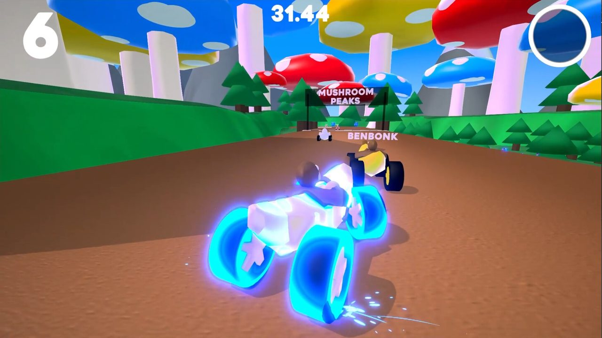
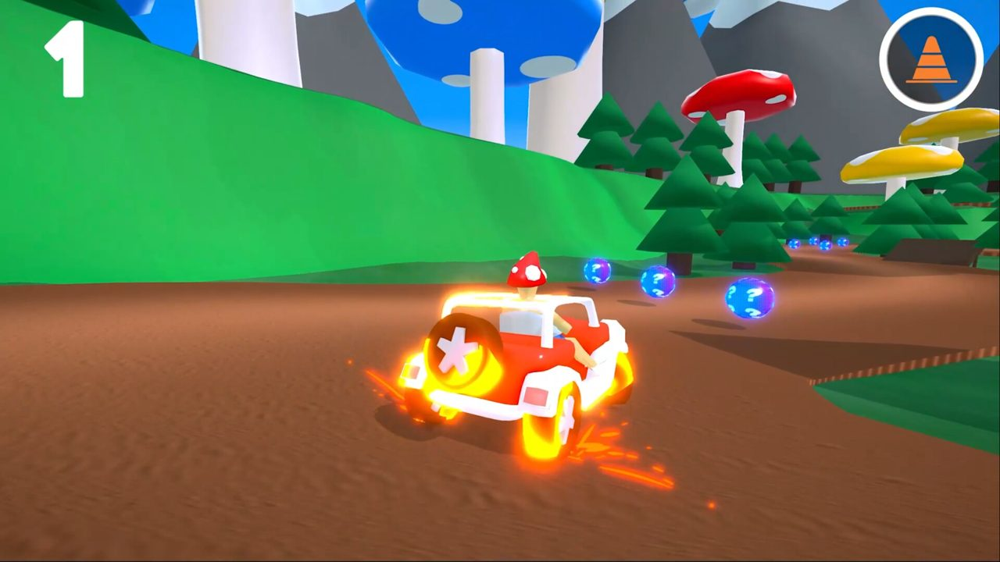
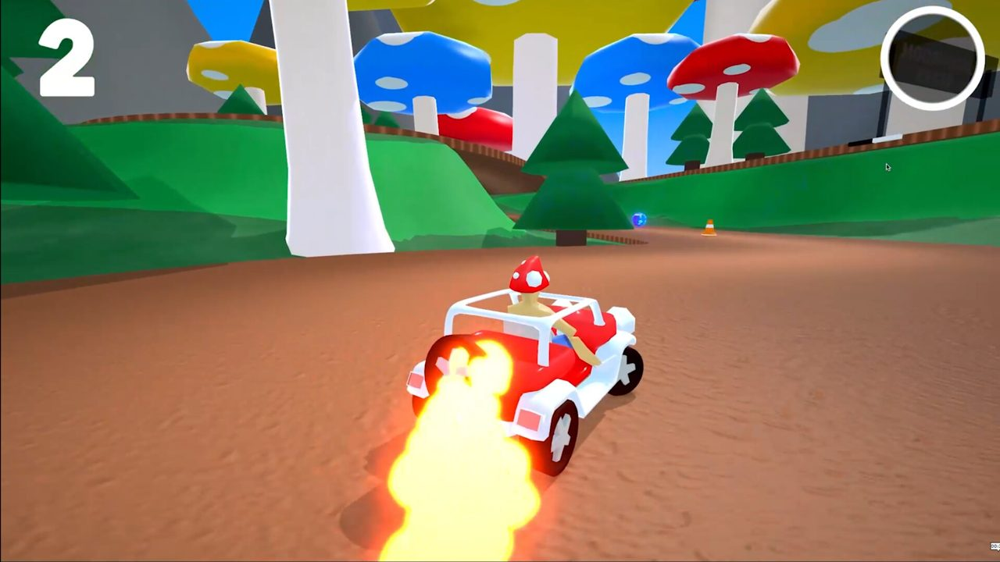

# Barji Kart — карточка стиля

- Steam: https://store.steampowered.com/app/2100980/Barji_Kart/
- Разработчик: Barji · 29 окт 2022
- Кластер: [cartoon-movement-arcade](../../genres/cartoon-movement-arcade.md)
- Теги: Racing, Combat Racing, Colorful, Stylized, Arcade, Third Person, Memes, Funny
- Суть: картинг с предметами до 10 игроков.

Листы: [скриншоты](img/shots_sheet.jpg) · [трейлер](img/frames_sheet.jpg) · Steam-скрин: https://shared.akamai.steamstatic.com/store_item_assets/steam/apps/2100980/ss_a008d8b7e6ac7b41e22b71530ad086006017b213.1920x1080.jpg

## Рендер
- [видно] Простейший яркий low-poly с плоскими цветами (Roblox/Mario Kart-lite), гладкие формы, мягкое затенение без текстур; трасса — коричневая земля с лёгким шумом.
- [видно] Гигантские грибы (красные/синие/жёлтые в белый горох), ёлки-конусы, зелёные холмы.

## Цвет и свет
- Палитра: `#36af89` / `#23796b` / `#2e4d40` зелень · `#7b402f` / `#8d5a43` / `#a2755e` дорога · `#b9c1ac` дымка · плюс **чистые красный, синий, жёлтый** грибов и неба `~#2f8fff`.
- Яркость 104, насыщенность 32% — **самая насыщенная игра пачки**.

## Камера
- [видно] Классическая камера за картом, немного сверху, FOV ~70°, номер позиции крупно слева сверху, слот предмета — круг справа.

## Персонажи
- [видно] Персонаж-гриб в маленьком белом/красном багги с колесом-звездой на спине.

## Анимация / VFX (главное)
- [видно] **Неоновые эффекты буста**: голубое/розовое свечение-обводка карта, электрические искры, огненный ореол оранжевым, реактивное пламя сзади. Bloom сильный именно на эффектах.
- [видно] Синие шарики-«ящики предметов» с «?».

## UI
- Белые жирные цифры позиции, тонкий белый круг слота, таймер сверху. Минимум.

## Как повторить в Three.js
- `MeshStandardMaterial` roughness 0.9, плоские цвета; мир — простые примитивы.
- Буст: дублирующий меш с аддитивным emissive (fresnel-шейдер) + three.quarks искры, Bloom (threshold 0.6, intensity 1.5) только по emissive.
- Камера: spring-follow (GSAP/lerp), FOV-кик на бусте.
