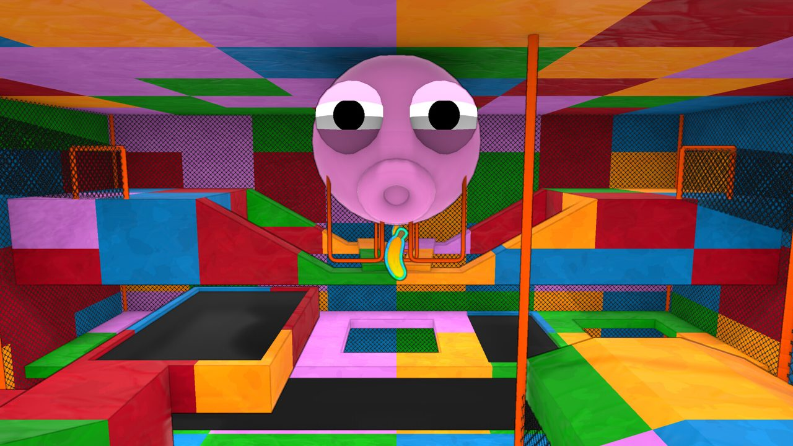
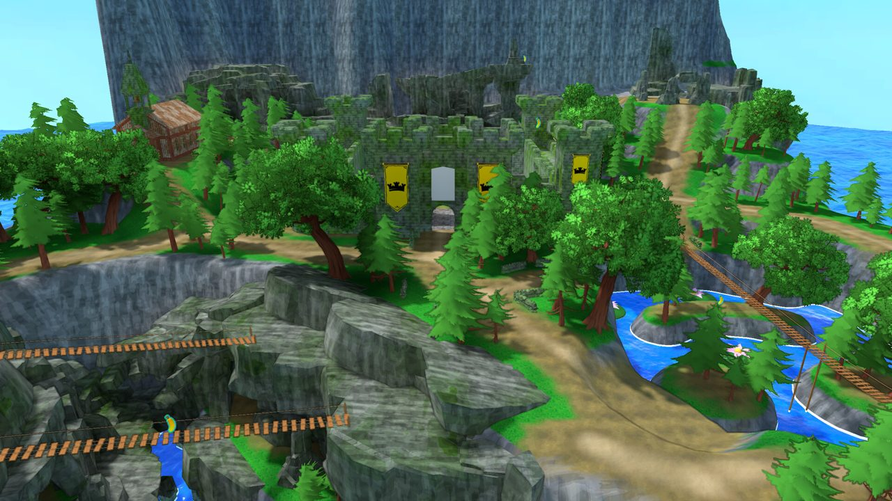
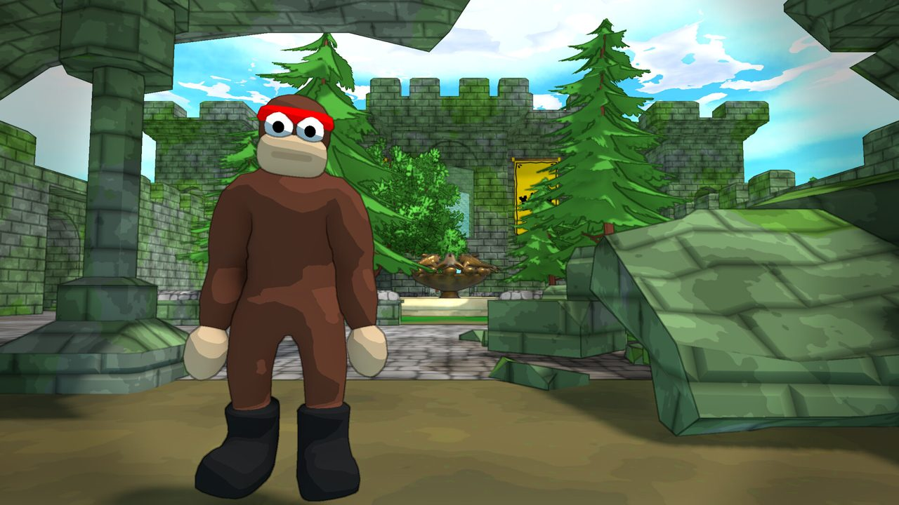

# Burg Tag — карточка стиля

- Steam: https://store.steampowered.com/app/4297360/Burg_Tag/
- Разработчик: Barji (соло-разработчик; тот же, что Barji Kart и Yellowcake) · 22 окт 2026
- Кластер: [cartoon-movement-arcade](../../genres/cartoon-movement-arcade.md)
- Теги: Parkour, Multiplayer, 3D Platformer, Party Game, Competitive, Character Customization
- Суть: онлайн-салки с паркуром (wall kick, swing, slide, roll), режим time trial.

Листы: [скриншоты](img/shots_sheet.jpg) · [трейлер](img/frames_sheet.jpg) · Steam-скрин: https://shared.akamai.steamstatic.com/store_item_assets/steam/apps/4297360/ba91480e4d4861b411eb8dd093ce8b995463b3bb/ss_ba91480e4d4861b411eb8dd093ce8b995463b3bb.1920x1080.jpg

## Рендер
- [видно] Яркий «Roblox/Gorilla Tag»-стиль: простые формы, **рисованные текстуры** (кирпич, мох, лёд с мазками), мягкий toon-ish свет. Есть ощущение раннего 3D-платформера (N64/GameCube) с современным светом.
- [видно] Уровни-тематики: ледяной остров, джунгли-руины, яркая детская игровая комната (клетки primary-цветов), контейнеровоз.
- [видно] Лёгкая тёмная обводка на некоторых объектах [гипотеза: через текстуры, не пост].

## Цвет и свет
- Палитра: `#74cfdb` бирюза воды/неба · `#1a4046` / `#317875` глубокая вода · `#443936` / `#997967` скалы и мех · `#e4e2a5` песок/свет · `#8a343c` красные контейнеры. Плюс чистые primary (красный, жёлтый, синий, зелёный, розовый) в игровой комнате.
- Яркость 106, насыщенность 30% — одна из самых насыщенных в пачке.
- [видно] Яркое солнце, голубое небо с мультяшными облаками, мягкие тени.

## Камера
- [видно] **FP с двумя большими кулаками-«булками»** в кадре (как Gorilla Tag), широкий FOV ~100°+, сильный motion feel: наклон камеры на wall-run [гипотеза].

## Персонажи
- [видно] Обезьяна-«бург» в бандане: коричневое тело, бежевое лицо-маска, **огромные глаза с толстыми красными веками**, большие перчатки и ботинки. Кастомизация шапок.
- Пропорции: короткие ноги, длинные руки, голова ~1/4.

## Анимация
- [видно] Руки качаются, «загребают» при беге; swing на канатах. Персонаж в меню — мягкий idle.
- [гипотеза] Движение физическое, импульсное, с сохранением инерции.

## VFX и пост
- Мало пост-эффектов: чистая картинка, лёгкий bloom. Скорость передаётся FOV и движением камеры.

## UI
- [видно] Жирный мультяшный шрифт с толстой тёмной обводкой (белый текст: «TAG», «TIME TRIALS», «GAME OVER!»). Логотип — жёлтый/синий с обводкой. Лутбокс-сундук в меню.

## Как повторить в Three.js
- `MeshToonMaterial` или `MeshStandardMaterial` roughness 0.9 + рисованные текстуры (Blender texture paint / процедурные мазки).
- Свет: `HemisphereLight` яркий + `DirectionalLight`, тени мягкие.
- FP-кулаки: два меша на отдельном слое, анимация GSAP/процедурная синусоида.
- Скорость: FOV +10–15° на рывке (GSAP), лёгкий roll камеры.
- UI: UIFX пресет «Roblox Cartoon», шрифт типа Lilita One/Luckiest Guy (OFL).
