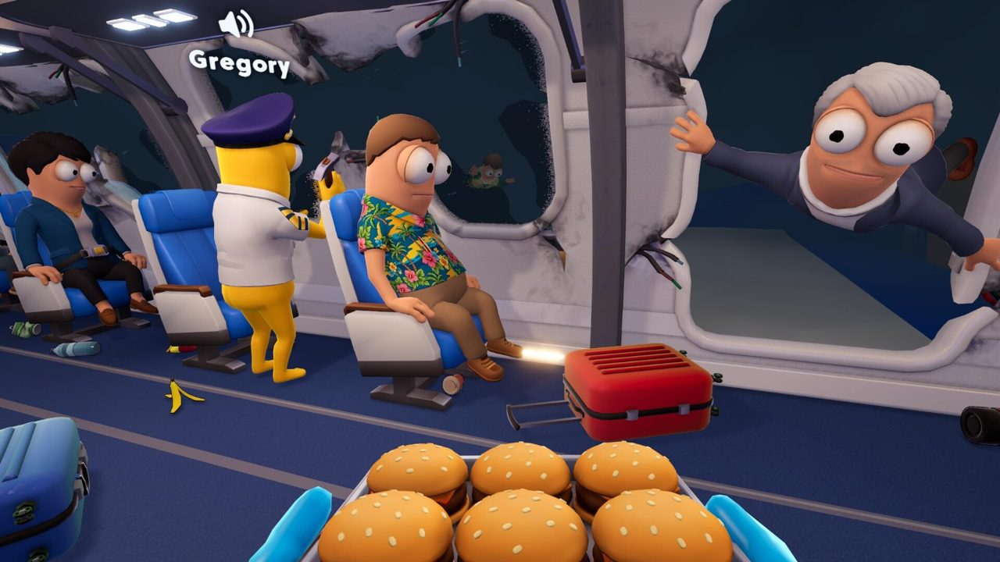
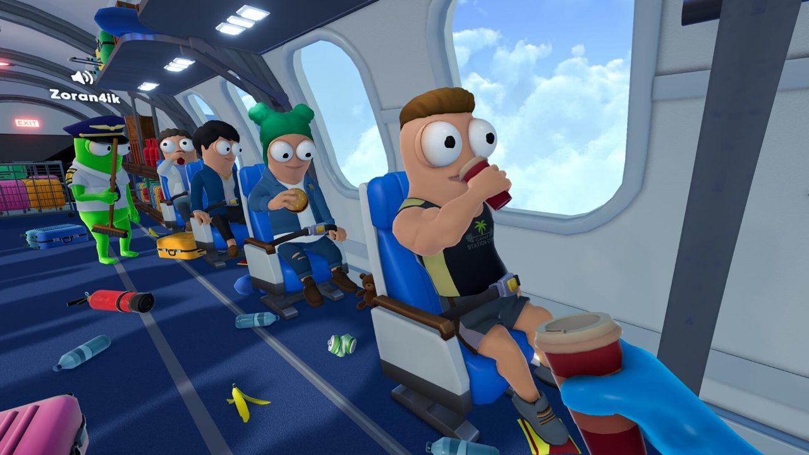
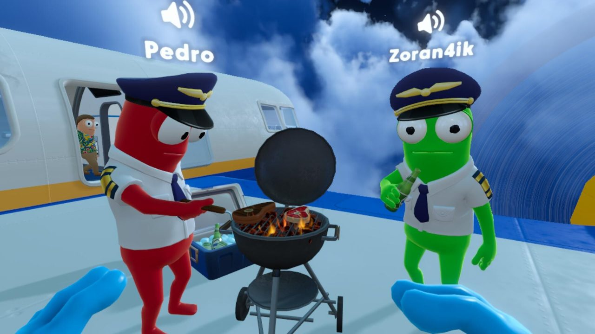

# Dear Passengers — карточка стиля

- Steam: https://store.steampowered.com/app/4534960/Dear_Passengers/
- Разработчик: FLEXUS · 2026
- Кластер: [coop-chaos-fp](../../genres/coop-chaos-fp.md)
- Теги: Co-op, Funny, Comedy, Physics, First-Person, Flight, Free to Play
- Суть: кооп-экипаж худшей авиакомпании: самолёт разваливается, груз нелегальный, пассажиры летают.

Листы: [скриншоты](img/shots_sheet.jpg) · [трейлер](img/frames_sheet.jpg) · Steam-скрин: https://shared.akamai.steamstatic.com/store_item_assets/steam/apps/4534960/b28210ec5549d2cda898099e6d4a5c29153b2f35/ss_b28210ec5549d2cda898099e6d4a5c29153b2f35.1920x1080.jpg

## Рендер
- [видно] Яркий мультяшный 3D в духе анимационного сериала: гладкие формы, чистые цвета, без обводки, мягкий PBR, лёгкий glossy на пластике кресел.
- [видно] Интерьеры насыщенные деталями-пропсами (чемоданы, бургеры, бананы, бутылки) — «насыпь хаоса».
- [видно] Повреждения: рваный металл, чёрная копоть, дыры в обшивке.

## Цвет и свет
- Палитра: `#1a1d29` тёмно-синий ковёр/тени · `#8ebfc9` небо/облака · `#518ca1` / `#234551` синий салона · `#ced7d3` белый пластик · `#a69690` кожа · акценты красный/жёлтый/зелёный (чемоданы, пилоты).
- Яркость 118, насыщенность 22% — светлая, холодно-голубая база с тёплыми яркими акцентами.
- [видно] Мягкий светлый день, большое небо с объёмными облаками; в салоне — потолочные лампы, ровный свет.

## Камера
- [видно] Первое лицо, широкий FOV, голубые перчатки-руки в кадре. Наклоны камеры при турбулентности [гипотеза], сильный «голландский угол» в моменты падения.

## Персонажи
- [видно] Главный приём: **огромные выпученные глаза-шары** с маленькими зрачками, узкие головы, длинные носы, тонкие ручки — стиль «Rick & Morty / Monkey Island-like». Пилоты — однотонные «человечки-бобы» (красный, зелёный, жёлтый) в фуражке и галстуке.
- Пропорции: голова ~1/3–1/4 роста, тонкие конечности.

## Анимация
- [видно] Ragdoll пассажиров, предметы летают в невесомости при разгерметизации; персонажи цепляются, болтаются.
- [гипотеза] Лицевая анимация глаз (вращение зрачков), squash на ударах.

## VFX и пост
- [видно] Облака (объёмные/спрайтовые), дым и огонь из двигателя, искры-«звёздочки» (стилизованные 4-конечные), снег, вода. Bloom умеренный, AO.

## UI
- [видно] Никнеймы над головами белым жирным шрифтом с иконкой динамика (voice chat). Почти нет HUD — всё диегетически (приборная панель, экран с картой самолёта).
- Логотип: красная/жёлтая плашка, мультяшный жирный шрифт.

## Как повторить в Three.js
- Материалы: `MeshStandardMaterial` roughness 0.5–0.7; пластик кресел roughness 0.35. Глаза — отдельные сферы с белым emissive 0.1 и чёрным зрачком-диском, вращаются lookAt.
- Свет: яркий `HemisphereLight` (`#cfe8ff` / `#3a4a6a`) + `DirectionalLight` белый; внутри салона — ряд `RectAreaLight` или emissive панели.
- Пост: N8AO, Bloom (threshold 0.8), AgX; облака — three.quarks billboard или sky dome.
- Хаос пропсов: Rapier, множество мелких динамических тел, sleep включён.
