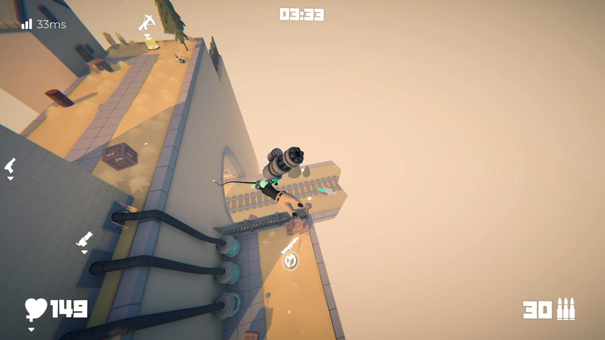
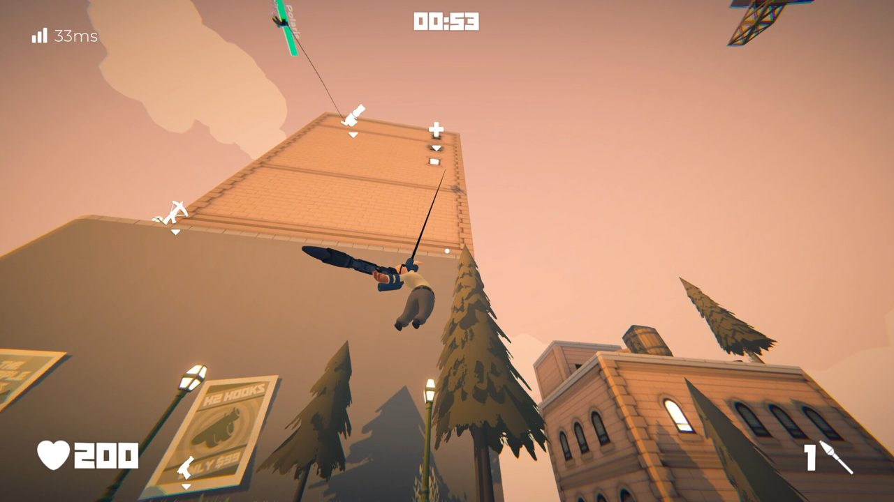
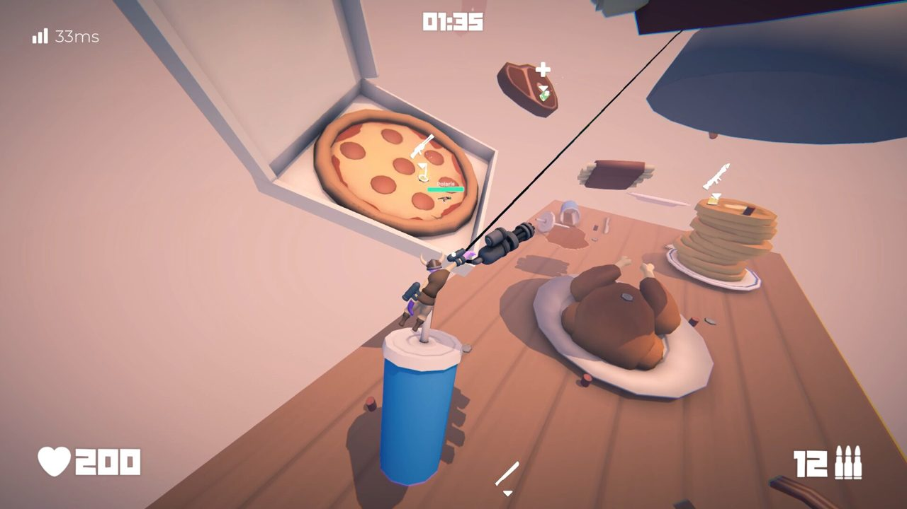

# Grapples Galore — карточка стиля

- Steam: https://store.steampowered.com/app/2239140/Grapples_Galore/
- Разработчик: Zoteling (тот же, что Gun Frog) · 7 фев 2025
- Кластер: [cartoon-movement-arcade](../../genres/cartoon-movement-arcade.md)
- Теги: Free to Play, Physics, Parkour, Arena Shooter, Active ragdolls, Third Person, Cartoon
- Суть: онлайн-арена с физическим крюком-кошкой, active ragdoll и стрельбой.

Листы: [скриншоты](img/shots_sheet.jpg) · [трейлер](img/frames_sheet.jpg) · Steam-скрин: https://shared.akamai.steamstatic.com/store_item_assets/steam/apps/2239140/ss_6b58d48a3504dcd6907beaab8be1c2484b9afb07.1920x1080.jpg

## Рендер
- [видно] **Мягкий пастельный low-poly с сильным атмосферным туманом** (стиль «Townscaper/ Totally Reliable»-лайт): плоские цвета, крупные формы, минимум деталей, текстур почти нет.
- [видно] Главный приём — **окраска всей сцены туманом одного тона** (персиковый, мятный, розовый): дальние объекты растворяются в цвете неба, ближние контрастнее. Отдельные карты — своя тональность.
- [видно] Мягкие тени, AO, без обводки.

## Цвет и свет
- Палитра: `#ddb794` / `#e8d8b8` персик-туман · `#ab977c` / `#8f7864` охра · `#5c645e` / `#3a3d3c` бетон · `#bfc09c` оливковый · варианты мятный `~#bfe0c4` и розовый `~#e8b8b0`.
- Яркость 130, насыщенность **15%** (самая приглушённая) — пастель, «пыльная» гамма.

## Камера
- [видно] Третье лицо, камера далеко и часто под сильными углами (снизу вверх на небоскрёбы), широкий FOV, ощущение высоты и скорости.

## Персонажи
- [видно] Маленькие низкополигональные человечки в кастомных шапках (викинг и т.п.), бирюзовые/цветные силуэты в интро. Гигантское оружие (миниган, базука).

## Анимация
- [видно] **Active ragdoll**: тело физически болтается на тросе, конечности тянутся инерцией. Крюк — тонкая чёрная линия.

## VFX и пост
- [видно] Взрывы — **чёрные чернильные кляксы-шары** (графичный стиль вместо огня), разлетающиеся точки. Портал — зелёное свечение. Виньетка + лёгкая хроматическая аберрация по краям [видно на скринах], лёгкое зерно [гипотеза].

## UI
- [видно] Белый жирный пиксельно-угловатый шрифт (сердце + HP слева снизу, патроны справа, таймер сверху). Логотип — белые наклонённые угловатые буквы.

## Как повторить в Three.js
- `MeshStandardMaterial` roughness 1, flat цвета, Smooth shading на крупных формах.
- **Fog = цвет неба**: `scene.fog = new Fog(skyColor, 30, 250)` + `scene.background = skyColor`; height-fog в шейдере (onBeforeCompile) для низин.
- Пост: N8AO, Vignette 0.35, ChromaticAberration offset 0.0015, Noise 0.03, ToneMapping AgX с пониженной насыщенностью (HueSaturation -0.15).
- Взрывы: three.quarks с чёрными сферическими спрайтами, scale-up + fade.
- Active ragdoll: Rapier, PD-моторы суставов к анимационной позе.
