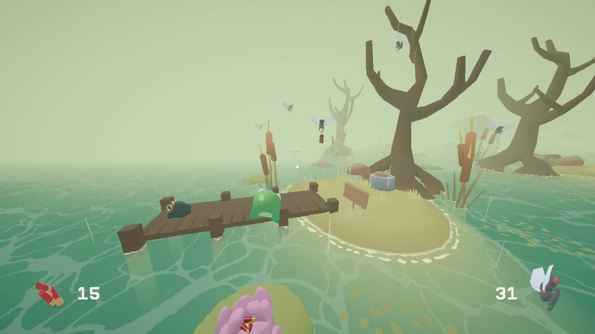
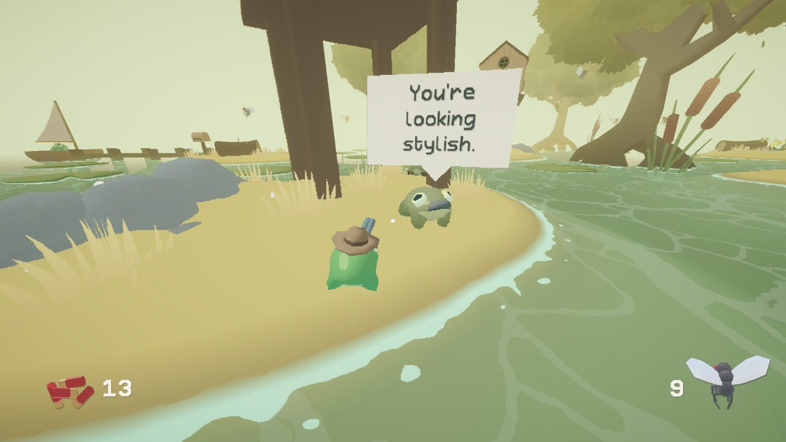
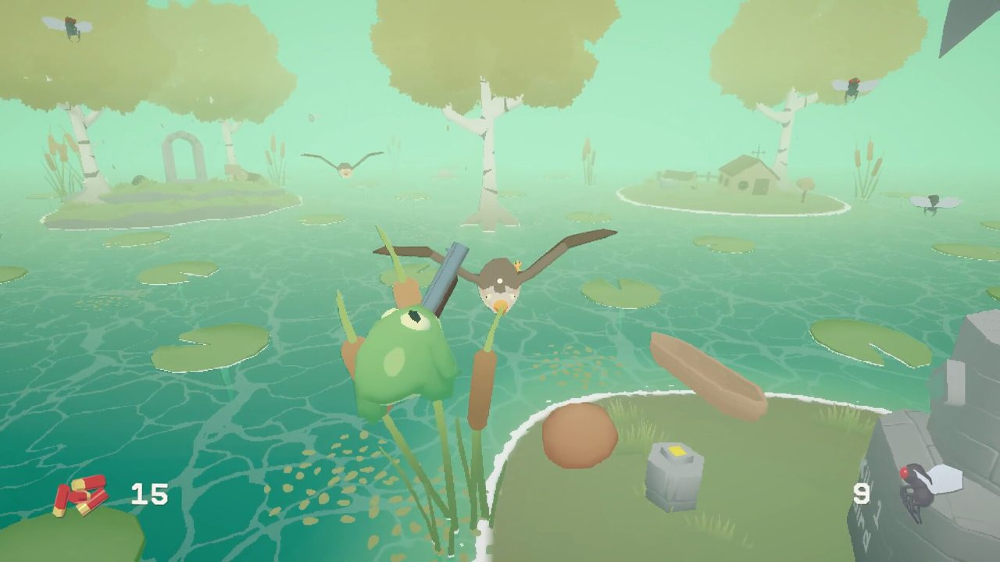

# Gun Frog — карточка стиля

- Steam: https://store.steampowered.com/app/3173130/Gun_Frog/
- Разработчик: Zoteling (тот же, что Grapples Galore) · 12 окт 2024
- Кластер: [cartoon-movement-arcade](../../genres/cartoon-movement-arcade.md) (одиночная, но стиль и движение того же типа)
- Теги: Physics, Fast-Paced, Third-Person Shooter, Colorful, Cute, Stylized, Bullet Time
- Суть: лягушка, проглотившая ружьё; прыжки по кувшинкам, отдача = движение, убиваешь мух.

Листы: [скриншоты](img/shots_sheet.jpg) · [трейлер](img/frames_sheet.jpg) · Steam-скрин: https://shared.akamai.steamstatic.com/store_item_assets/steam/apps/3173130/2547e9b0a9e0e18a59fe4e988c380db3630fc1fa/ss_2547e9b0a9e0e18a59fe4e988c380db3630fc1fa.1920x1080.jpg

## Рендер
- [видно] Мягкий пастельный стилизованный 3D, **сцена тонирована мятно-зелёным туманом**, гладкие формы, кроны деревьев — простые «облачка». Без обводки.
- [видно] **Вода — главный элемент**: бирюзовая с рисованной сеткой каустик-линий (светлые «трещины»), белые пунктирные линии пены вокруг островов.
- [видно] Деревья — сухие «корявые» силуэты, рогоз, кувшинки.

## Цвет и свет
- Палитра: `#bfe0bc` / `#8dbe92` мятный туман и небо · `#599673` / `#7ea980` вода · `#637659` / `#88976f` болотная зелень · `#bac095` песок · `#171b16` тени. Акценты: красный (патроны, гриб), розовый цветок.
- Яркость **145** (самая светлая), насыщенность 18% — пастель.
- [видно] Рассеянный мягкий свет, почти без жёстких теней; тени — мягкие пятна.

## Камера
- [видно] Третье лицо сзади-сверху, средняя дистанция; bullet time замедляет [по тегам].

## Персонажи
- [видно] Круглая зелёная лягушка-«капля» с ружьём во рту, кастомные шляпы. Враги — пауки, птицы, мухи-крупные. NPC с речевыми бумажными «табличками» (белый лист с рукописным шрифтом).

## Анимация
- [видно] Отдача выстрела = прыжок; squash & stretch лягушки [гипотеза]; мухи разлетаются кусками.

## VFX
- [видно] Белые мягкие клубы дыма-«облачка» при выстреле, перья/куски при попадании, фиолетовые лучи-трейлы.

## UI
- [видно] Минимум: патроны (красная иконка) слева снизу, мухи-валюта справа снизу, моноширинный белый шрифт. Подсказки «PRESS E».

## Как повторить в Three.js
- Туман = цвет неба (мятный), как в Grapples Galore.
- Вода: `ShaderMaterial` — базовый бирюзовый + анимированный voronoi-узор (светлые линии) + пунктирная пена по SDF расстояния до берега (или текстура-маска).
- Пост: N8AO мягкий, Bloom слабый, HueSaturation -0.1, лёгкая виньетка.
- Дым: three.quarks белые сферические спрайты с мягким краем.
