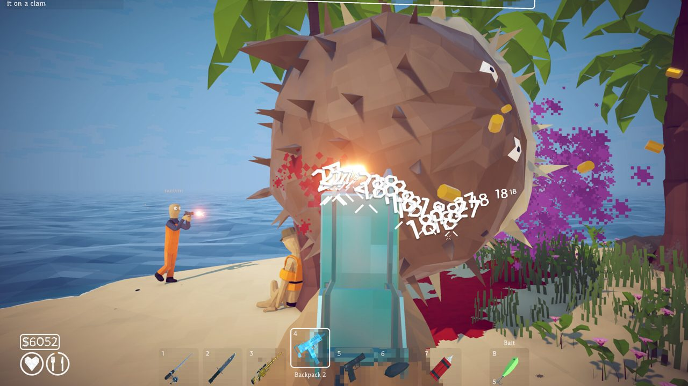
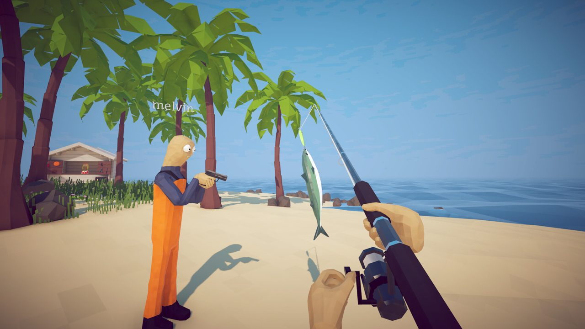
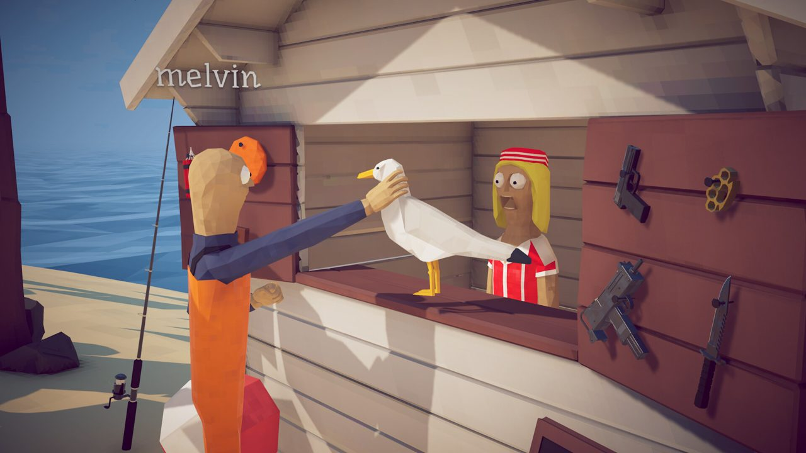

# How to Fish — карточка стиля

- Steam: https://store.steampowered.com/app/4001890/How_to_Fish/
- Разработчик: Dazed Games (при поддержке Landfall) · 20 авг 2026
- Кластер: [coop-chaos-fp](../../genres/coop-chaos-fp.md)
- Теги: Co-op, Fishing, Physics, First-Person, Shooter, Nature, Cartoony
- Суть: 1–4 игрока застряли на острове, «рыбачат» удочкой, снайперкой и чем угодно; абсурдный юмор.

Листы: [скриншоты](img/shots_sheet.jpg) · [трейлер](img/frames_sheet.jpg) · Steam-скрин: https://shared.akamai.steamstatic.com/store_item_assets/steam/apps/4001890/48f6817fe466a7c9666605527558bf1fac48d0d2/ss_48f6817fe466a7c9666605527558bf1fac48d0d2.1920x1080.jpg

## Рендер
- [видно] **Чистый low-poly flat-shading** (крупные грани видны, без текстур), как у Landfall (TABS/Totally Accurate). Вода — low-poly с гранями и белой пеной у берега.
- [видно] Трава — плотные низкополигональные пучки; пальмы — грани-листья.
- [видно] Чёткие жёсткие тени от солнца, лёгкий AO, без обводки.

## Цвет и свет
- Палитра: `#5a88a1` / `#78afcd` море и небо · `#cec2ab` песок · `#384d62` глубина/тени · `#6d4147` кровь/дерево · зелень травы `~#4f9a3a` [гипотеза] · оранжевая роба `~#e8771c`.
- Яркость 115, насыщенность 22%. Синяя доминанта, мягкая дымка до горизонта, светлое небо.
- [видно] Яркий дневной свет, ночная сцена с луной — синяя.

## Камера
- [видно] FP, видны руки с удочкой/оружием, ADS через оптику (круглая маска прицела). FOV средний (~80°).

## Персонажи
- [видно] Простые «бобы»: голова-капсула без шеи, жёлтая кожа, глаза-точки / большие белые глаза; оранжевые робы как у заключённых. Длинные тонкие руки (TABS-образные).

## Анимация
- [видно] Физичные ragdoll-рыбы и люди, рыба трепыхается на крючке, выстрел отбрасывает тела.
- [видно] Кровь — красные **кубики-частицы** (вокселями), разлетаются и остаются на земле пятнами. Это комедийный приём.

## VFX и пост
- [видно] Яркий bloom на гриле (оранжевые угли-кубики), всплески воды, дымка; виньетка лёгкая. Всплывающие числа урона и текст комбо («Headshot», «Endangered Species»).

## UI
- [видно] Минимальный: иконки сердца/еды слева снизу, хотбар снизу, денежный счётчик, бар здоровья босса сверху. Шрифт логотипа — с засечками, белый, мягкий.

## Как повторить в Three.js
- Модели low-poly без сглаживания: `flatShading: true`, `MeshStandardMaterial` roughness 1, цвета через vertex colors.
- Вода: плоскость с низким сегментом + вершинная анимация волн в шейдере, flatShading, полупрозрачная пена по маске глубины.
- Свет: сильный `DirectionalLight` + `HemisphereLight`, тени жёстче (radius 1–2). `Fog` голубой `#a9c9dc`.
- Пост: N8AO, Bloom (для огня/углей), лёгкая виньетка.
- Кровь-кубики: three.quarks с mesh-частицами BoxGeometry, коллизия с землёй → декали.
