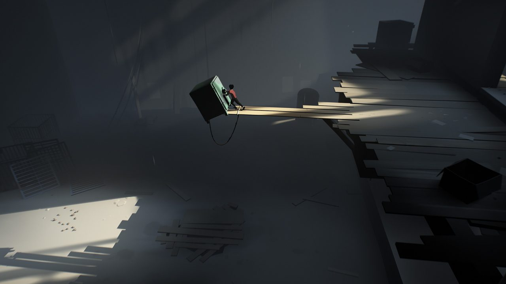
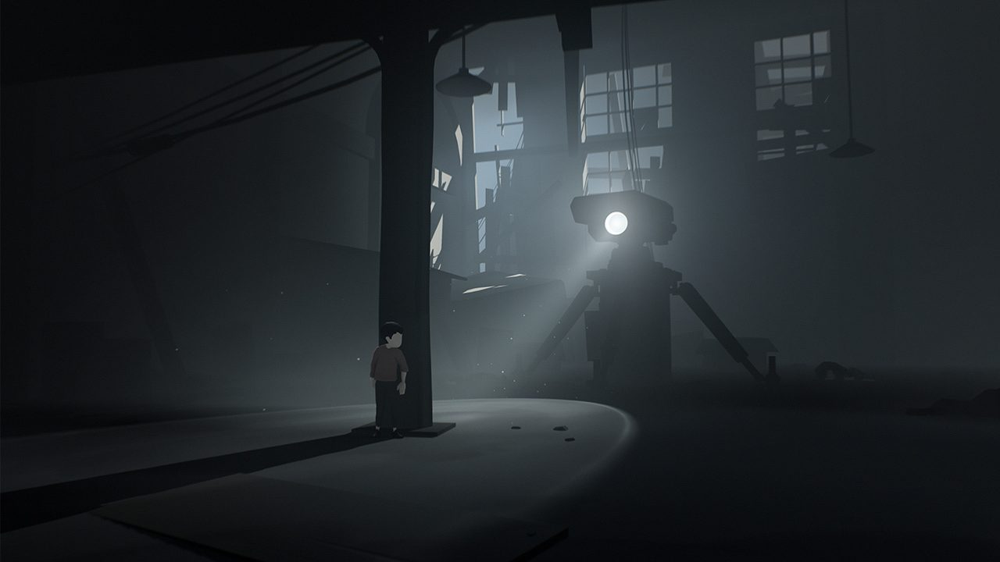
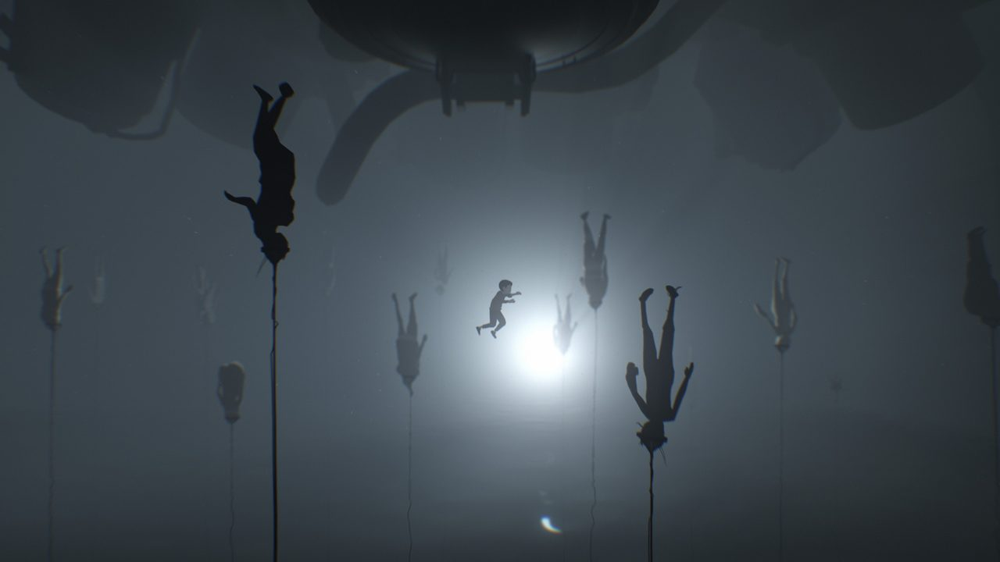

# INSIDE — карточка стиля

- Steam: https://store.steampowered.com/app/304430/INSIDE/
- Разработчик: Playdead (создатели LIMBO) · 7 июл 2016
- Кластер: [horror](../../genres/horror.md), линия «мрачный минимализм»
- Теги: 2.5D, Puzzle Platformer, Atmospheric, Dark, Horror, Cinematic, Minimalist
- Суть: мальчик бежит через мрачный «проект» и решает физические головоломки. Сюжет без слов, камера сбоку.

Листы: [скриншоты](img/shots_sheet.jpg) · [трейлер](img/frames_sheet.jpg) · Steam-скрин: https://shared.akamai.steamstatic.com/store_item_assets/steam/apps/304430/ss_d23769199f1e3d498f8293892f0456696458c717.1920x1080.jpg

## Рендер
- [видно] **Почти монохромный 3D**: гладкие формы без текстур, материалы почти без деталей. Вся картинка держится на свете, тумане и силуэтах.
- [видно] **Персонажи без лиц**: гладкие безликие фигуры. Единственное цветовое пятно на всю игру — красная кофта героя.
- [видно] Объёмный свет: лучи из окон и прожекторов, световые конусы с пылью, контровой свет на силуэтах.
- [видно] Многослойная глубина: передний план тёмный силуэт, средний (герой) в свету, задний растворён в тумане.

## Цвет и свет
- Палитра: `#000000` / `#07090a` / `#151315` чёрные массы · `#191f22` / `#31393d` графитовый туман · `#626f75` холодный серо-голубой свет. Акцент красный `~#8e2a26`, только на герое и в логотипе.
- Яркость **34** (самая тёмная во всей библиотеке), насыщенность **4%**, по сути ч/б с холодным оттенком.
- [видно] Один-два сильных источника на сцену (окно, прожектор, лампа), остальное в тени. Густой туман, на улице дождь.

## Камера
- [видно] Строго сбоку (2.5D), ортогонально-перспективная. Камера медленно ведёт героя, на ключевых моментах отдаляется для масштаба. Длинные статичные кадры.

## Персонажи
- [видно] Реалистичные пропорции, но силуэт упрощён: без лиц и мелких деталей. Толпы одинаковых фигур («зомби-люди»), висящие тела. Хоррор в масштабе и безличности.

## Анимация
- [видно] Очень плавная, весомая анимация бега и прыжков с сохранением инерции; герой хватается за уступы. Тело физично, смерти показаны жёстко.
- [гипотеза] Процедурное смешивание анимаций с физикой (IK рук и ног).

## VFX и пост
- [видно] Volumetric light shafts, пыль в лучах, дождь, сильный туман по глубине, мягкий bloom на источниках, лёгкое зерно, глубокая виньетка. Под водой мутная дымка с лучами.

## UI
- [видно] **UI нет совсем**: ни HUD, ни подсказок. Логотип: высокий узкий гротеск, тёмно-красный.

## Как повторить в Three.js
- `MeshStandardMaterial` roughness 1, цвета в диапазоне #0a–#40, без текстур; герою одна красная деталь.
- Свет: 1 `SpotLight` или `DirectionalLight` с узкими тенями + слабый `AmbientLight` (0.05). Volumetric: GodRaysEffect из postprocessing или конусы с additive-шейдером и шумом.
- `FogExp2` `#20272b`, density 0.04–0.08 (туман главнее всего).
- Пост: Bloom (threshold 0.7), Noise 0.06, Vignette 0.6 darkness 0.8, ToneMapping AgX + HueSaturation -0.8.
- Камера: `PerspectiveCamera` FOV 30–35 (узкий, «кинематографичный»), ведение сбоку через lerp.
