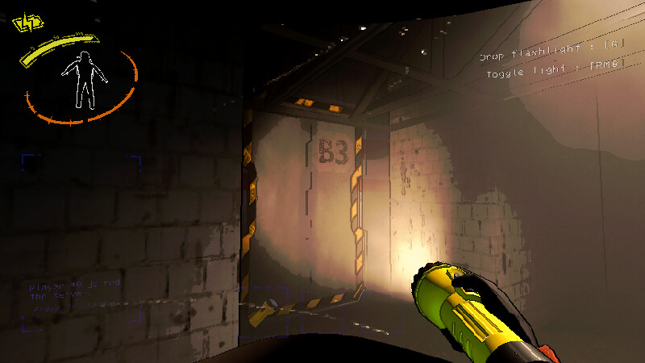
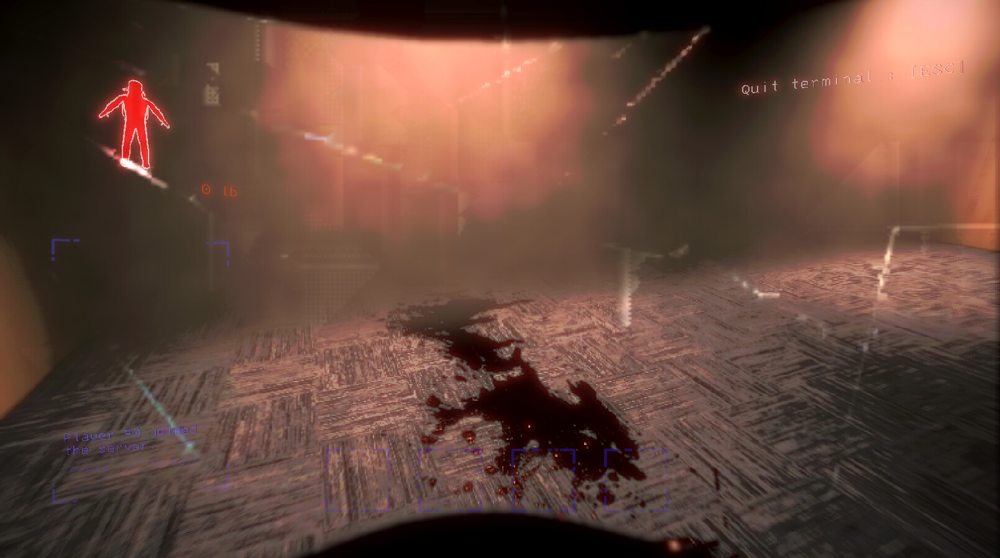
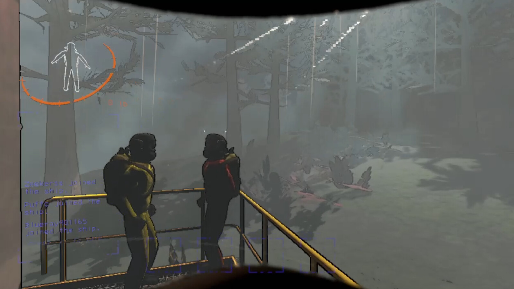

# Lethal Company — карточка стиля

- Steam: https://store.steampowered.com/app/1966720/Lethal_Company/
- Разработчик: Zeekerss · 23 окт 2023
- Кластер: [horror](../../genres/horror.md), линия B «ретро-кооп хоррор» (эталон жанра, на нём выросла Shift At Midnight и вся волна); пересекается с [coop-chaos-fp](../../genres/coop-chaos-fp.md)
- Теги: Online Co-Op, Horror, First-Person, Survival Horror, Funny, Exploration, Psychological Horror, Sci-fi, PvE, Procedural Generation
- Суть: кооп до 4 «сотрудников Компании»: летишь на заброшенные луны, собираешь хлам в процедурных комплексах, сдаёшь за квоту. Монстры, темнота, голосовой чат с затуханием по расстоянию.

Листы: [скриншоты](img/shots_sheet.jpg) · [трейлер](img/frames_sheet.jpg)

## Рендер
- [видно] **Низкое внутреннее разрешение** (картинка растянута, крупный пиксель) + **постеризация** (ступенчатые цветовые полосы в градиентах света, см. фонарик на стене) + тонкая **тёмная обводка** по краям объектов.
- [видно] Low-poly геометрия, простые текстуры бетона, кирпича, металла. Детализация низкая, атмосферу создают свет, туман и пост.
- [видно] **Визор шлема**: тёмная изогнутая рамка сверху и снизу кадра, лёгкий фишай по краям.
- [гипотеза] Unity HDRP с custom pass: рендер ~860×520, posterize + edge-detect outline.

## Цвет и свет
- Палитра: `#000000` / `#191713` темнота · `#393a36` / `#736a64` бетон и туман · `#a19582` свет фонарика · `#6c4a41` / `#4a231e` ржавый красный.
- Яркость 59, насыщенность 9%.
- [видно] Почти бесцветная серо-коричневая база + **насыщенные акценты**: оранжевые костюмы, жёлто-чёрные полосы опасности, красные шкафчики, зелёный терминал, кровь.
- [видно] Густой объёмный туман снаружи (луны), внутри — абсолютная темнота, видно только в конусе фонарика. Красный туман-заливка в «опасных» комнатах.

## Камера
- [видно] FP, рука с предметом снизу справа (фонарик, рация, знак «Стоп», мелкий хлам). FOV ~66, покачивание при ходьбе.

## Персонажи
- [видно] Безликие фигуры в оранжевых скафандрах со шлемом и баллоном, без лиц. Монстры: силуэты, светящиеся глаза, «коилхэд», паук.
- [видно] Юмор: ragdoll, игрушечный робот, гудок, танцы, голос в рацию.

## VFX и пост
- [видно] Объёмный туман, конус фонарика с ореолом, искры, кровь-лужи, зелёный «сканер» (волна по полу с подсветкой лута).
- [видно] Зерно и шум в трейлере, плёночные ромбы-помехи.

## UI (сильная сторона)
- [видно] **Диегетический HUD шлема**: оранжевая дуга-индикатор здоровья вокруг контура человечка слева сверху, вес «21 lb», подсказки клавиш справа сверху моноширинным белым («Drop Flashlight : [G]»), синие уголки-скобки по углам визора.
- [видно] Терминал корабля: зелёный текст на чёрном, моноширинный, ввод команд. Табличка «PILOT COMPUTER» в рамке.
- [видно] Промо: плакат «THE COMPANY IS HIRING!» в ретро-пропаганде (красный фон, растр точек, указующая рука), «IT'S EASY!» белыми буквами с наклоном. Логотип: оранжевый трафарет в рамке.

## Как повторить в Three.js
- Рендер в `WebGLRenderTarget` 1/2–1/3 разрешения, вывод с `NearestFilter` (крупный пиксель).
- Пост (postprocessing, свой Effect): posterize 6–8 уровней на канал + Sobel-обводка по глубине/нормалям, затем виньетка-визор (маска шлема PNG сверху/снизу), лёгкий barrel distortion, зерно.
- Свет: `SpotLight` фонарика с `decay` 2 и мягким краем, внутри комплексов ambient ≈ 0, снаружи `FogExp2` серо-коричневый 0.03–0.05. Красные зоны — `PointLight #ff2a1a` + красный туман.
- HUD: DOM-оверлей c моноширинным шрифтом (VT323 / IBM Plex Mono, OFL), SVG-дуга здоровья, уголки визора.
