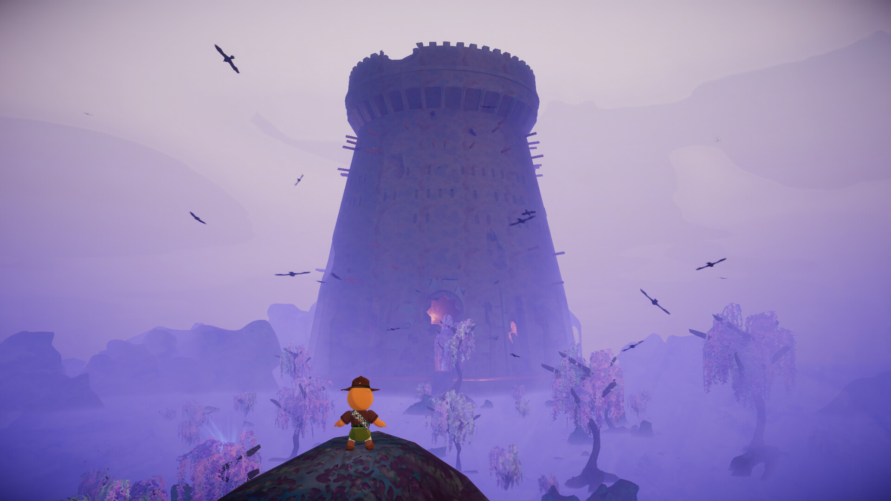
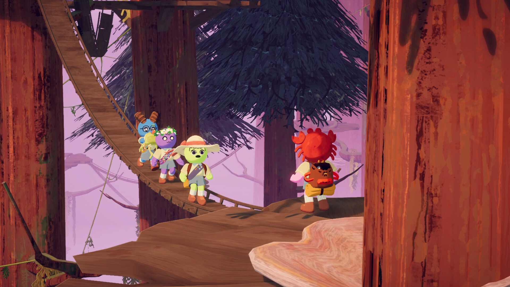
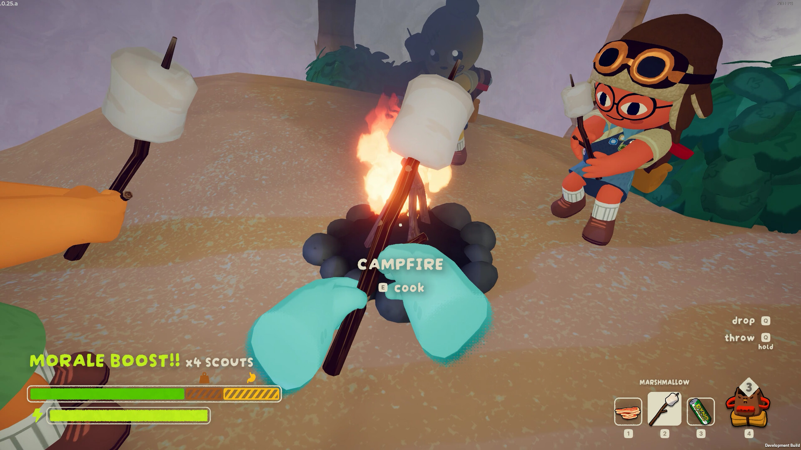

# PEAK — карточка стиля

- Steam: https://store.steampowered.com/app/3527290/PEAK/
- Разработчик: Team PEAK (Landfall + Aggro Crab) · 16 июн 2025
- Кластер: [coop-chaos-fp](../../genres/coop-chaos-fp.md), вариант E «тун-приключение в цветном воздухе»
- Теги: Online Co-Op, Adventure, Physics, Exploration, First-Person, Comedy, Procedural Generation, Atmospheric
- Суть: кооп до 4 скаутов, процедурный остров, восхождение на гору через биомы (пляж, джунгли, снег, меза, вулкан). Стамина, еда, верёвки, падения ragdoll.

Листы: [скриншоты](img/shots_sheet.jpg) · [трейлер](img/frames_sheet.jpg)

## Рендер
- [видно] **Тун-шейдинг с 2–3 ступенями тени** на гладких скруглённых формах, без обводки. Тени мягко-ступенчатые, цвет тени тёплый/фиолетовый, не серый.
- [видно] Текстур почти нет: однотонные заливки, на скалах и коре лёгкие рисованные мазки и трещины.
- [видно] Растительность — крупные стилизованные листья-карточки (пальмы, ели, лианы), мухоморы как ориентиры.
- [гипотеза] Unity URP, кастомный toon-lit с рампой; лицо — декаль/текстура поверх головы.

## Цвет и свет
- Палитра: `#36252e` / `#1b202b` тени · `#e2c9ad` песок/небо · `#a17371` / `#632e31` скалы мезы · `#b0baae` снег/туман · `#5c5e5c` камень.
- Яркость 93, насыщенность 16% (по кадрам).
- [видно] **Каждый биом = свой цвет воздуха**: лиловый туман у башни, бирюзово-мятный у снега, персиковый в мезе, красно-оранжевый у вулкана, зелёно-сизый в джунглях. Туман густой, по глубине силуэты растворяются в тон неба.
- [видно] Солнце тёплое, мягкое; огонь и лава дают сильный bloom.

## Камера
- [видно] FP, **крупные мультяшные руки-варежки** (мятные/жёлтые перчатки), FOV широкий ~90. Карабкаешься — руки тянутся к уступу.
- [видно] В трейлере много кадров со стороны (вид на группу на скале) — для промо.

## Персонажи
- [видно] Пухлые «скауты» без шеи, голова-шар, **плоское нарисованное лицо**: точки/овалы глаз, очки, румянец. Разные цвета кожи (оранжевый, голубой, розовый, зелёный), шапки (гриб-мухомор, лётный шлем с очками, панама), рюкзаки.
- [видно] Пропорции игрушечные, ноги короткие. Юмор — в позах и падениях.

## Анимация
- [видно] Процедурное лазание руками, ragdoll при падении и «Knocked out.», болтание на верёвке, переходы по канатному мосту.
- [гипотеза] Активный ragdoll с физическими руками (как у Landfall).

## VFX и пост
- [видно] Огонь костра, лава с трещинами-свечением, торнадо в мезе, дым, искры, пыль. Bloom на огне и небе.
- [видно] Плотный цветной туман — главный пост-приём, плюс мягкий AO.

## UI
- [видно] Минимальный HUD внизу слева: полоса стамины (зелёная) со штриховкой голода/холода, слоты предметов снизу справа, значок рюкзака. Подсказки «ROPE · grab», «CAMPFIRE · cook» по центру.
- [видно] Субтитры голосом друзей цветным мелким текстом внизу; всплывающее «MORALE BOOST!! x4 SCOUTS» жирным зелёным.
- [видно] Логотип: толстые белые скруглённые буквы.

## Как повторить в Three.js
- `MeshToonMaterial` с `gradientMap` на 3 ступени (NearestFilter) или свой ShaderMaterial с рампой и цветной тенью; roughness не нужен.
- Лицо — `DecalGeometry` или текстура-атлас на сфере головы; глаза меняются кадрами атласа.
- `FogExp2` с цветом = цвет неба биома, плотность 0.015–0.03; меняй цвет тумана, неба и солнца на смене биома (GSAP).
- Пост: N8AO мягкий, Bloom threshold 0.85 на огне/лаве, AgX, лёгкая виньетка. Без зерна.
- Физика: Rapier, руки — kinematic цели с IK, падение — ragdoll.
