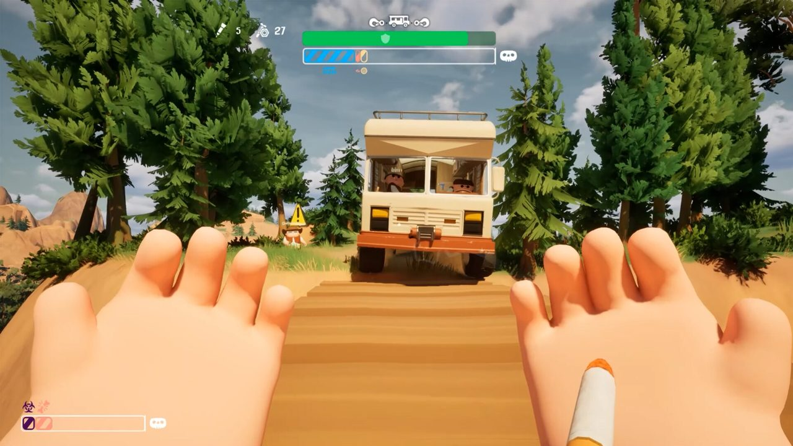
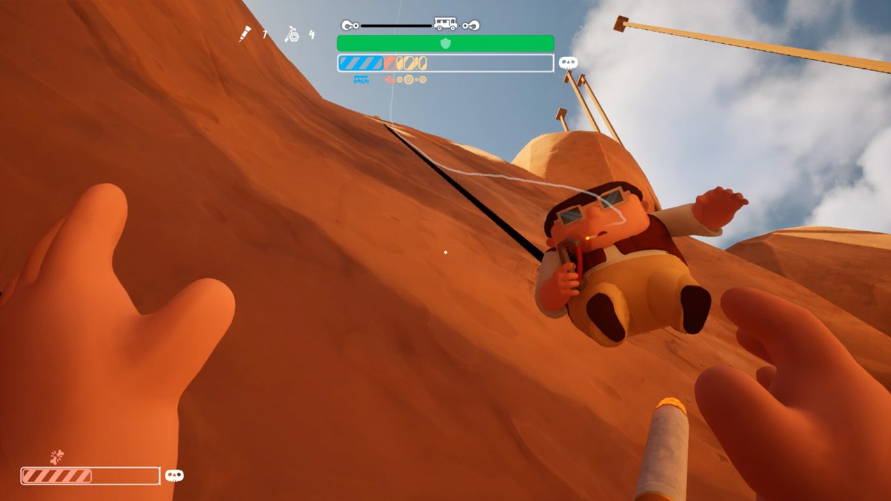
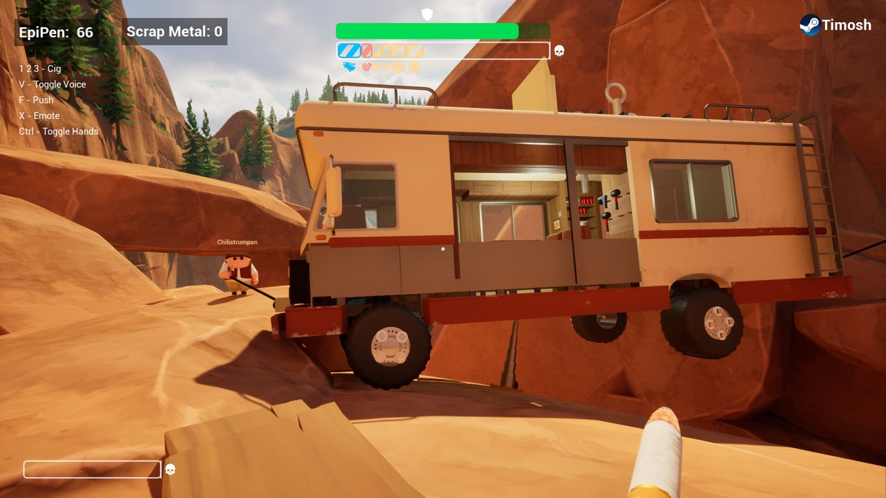

# RV There Yet? — карточка стиля

- Steam: https://store.steampowered.com/app/3949040/RV_There_Yet/
- Разработчик: Nuggets Entertainment · релиз 21 окт 2025
- Кластер: [coop-chaos-fp](../../genres/coop-chaos-fp.md)
- Теги: Co-op, Funny, Driving, Physics, Exploration, First-Person, Atmospheric, Offroad
- Суть: кооп от первого лица, команда тащит дом на колёсах домой по бездорожью (лебёдка, пульт, ремонт, ragdoll падения).

Листы: [скриншоты](img/shots_sheet.jpg) · [трейлер 1 кадр/с](img/frames_sheet.jpg) · Steam-скрин: https://shared.akamai.steamstatic.com/store_item_assets/steam/apps/3949040/ed2f7080c6622688a72a86ca85af600f2a2bdfb9/ss_ed2f7080c6622688a72a86ca85af600f2a2bdfb9.1920x1080.jpg

## Рендер
- [видно] Стилизованный «пластилиновый/глиняный» 3D: гладкие формы, без обводки, почти без мелких текстур, мягкий PBR с высокой шероховатостью (roughness ~0.7–0.9).
- [видно] Скалы — крупные скруглённые массы с мягким градиентом, без детального шума. Деревья — low-poly ёлки, но с мягким светом.
- [видно] Реалистичный свет поверх мультяшных форм: тёплое солнце, мягкие тени, ambient occlusion, лёгкий bloom на небе. Это главный приём: «игрушка в настоящем свете».

## Цвет и свет
- Палитра (по кадрам): `#ba7b45` охра скал · `#e7bb82` песок · `#804b28` / `#6c2e14` тени скал · `#34321d` хвоя · `#adaf89` трава/дымка · небо голубое `~#8fc4ea` [гипотеза по кадрам].
- Средняя яркость 101/255, насыщенность 27% — тёплая, приглушённая, «закатная» гамма.
- [видно] Солнце низкое-среднее, тёплый ключ + голубой skylight, лёгкий воздушный туман на дальних планах, объёмные облака.

## Камера
- [видно] Первое лицо, FOV широкий (~90–100° по горизонтали, гипотеза), руки персонажа крупно в кадре.
- [видно] Внутри RV — тесный интерьер, вид на панель приборов с аналоговыми стрелками.

## Персонажи и объекты
- [видно] Пухлые «дедушки-туристы»: большая голова (~1/3 роста), маленькие ноги, толстые пальцы, круглые очки, шляпы. Без пальцевой детализации ногтей, кожа гладкая.
- [видно] Руки игрока — гипертрофированные мягкие «колбаски», с сигарой/спичкой.
- [видно] RV — винтажный кемпер 70-х: бежевый с коричневыми полосами, клетчатые шторы, дерево внутри.

## Анимация
- [видно] Активный ragdoll: персонажи болтаются на тросе, падают кучей. Физика машины тяжёлая, подвеска качается.
- [гипотеза] Руки FP анимированы процедурно (тянутся к предмету), лёгкий bob при ходьбе.
- [видно] Предметы «в руке» — пульт лебёдки, инструкции-книжки (диегетический UI).

## VFX и постобработка
- [видно] Пыль из-под колёс, мягкий bloom, AO, тёплый тонмаппинг (ACES/AgX-подобный), туман по глубине. Зерна/виньетки почти нет.

## UI
- [видно] Минимальный HUD сверху по центру: полоски здоровья и прогресса, иконки; подсказки клавиш справа мелким текстом. Диегетические предметы (пульт с кнопками FRONT/REAR, инструкция-книжка).
- Шрифт заголовка — пиксельный/ретро с зелёной плашкой (логотип).

## Как повторить в Three.js (THREEJS_STACK)
- `MeshStandardMaterial` roughness 0.8, metalness 0, плоский цвет + лёгкий vertex-color градиент; формы скруглять в Blender (Bevel + Subdivision 1–2, Shade Smooth).
- Свет: `DirectionalLight` тёплый `#ffd9a8` intensity ~3, `HemisphereLight` небо `#9ccfff` / земля `#a0703f`; мягкие тени PCFSoft, shadow radius 4–6.
- Пост: N8AO (radius ~1.5, intensity 2), Bloom слабый (threshold 0.85), ToneMapping AgX, `FogExp2` тёплый `#d9b58a` density 0.004.
- FP-руки: отдельная сцена/слой поверх, FOV 85–95.
- Ragdoll: Rapier, связки через `ImpulseJoint`.
