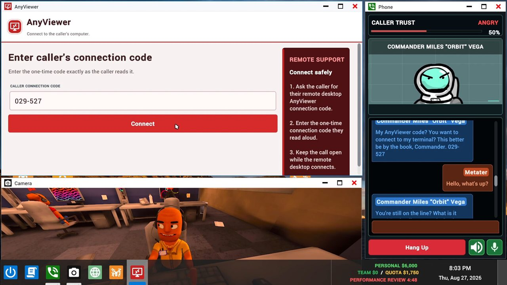
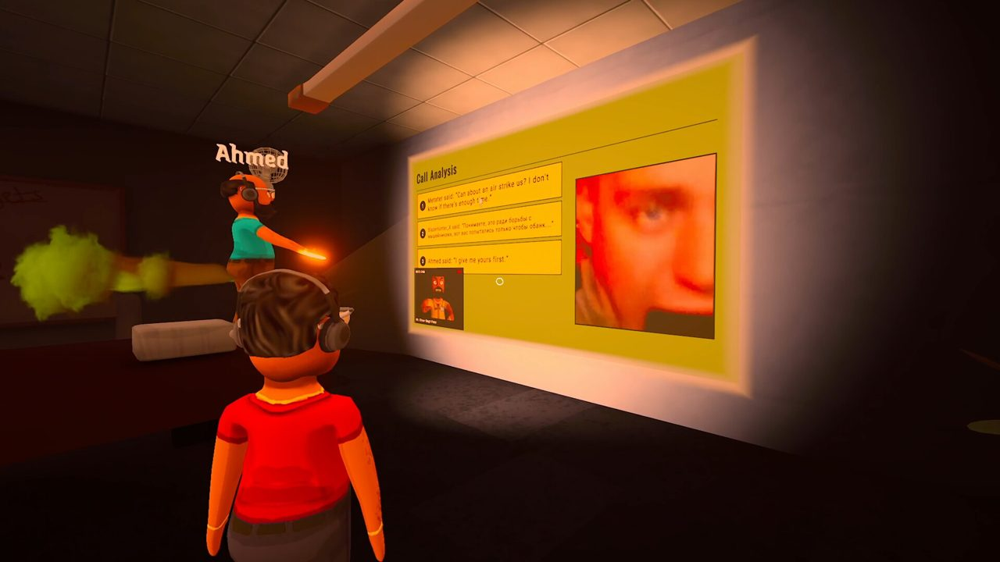
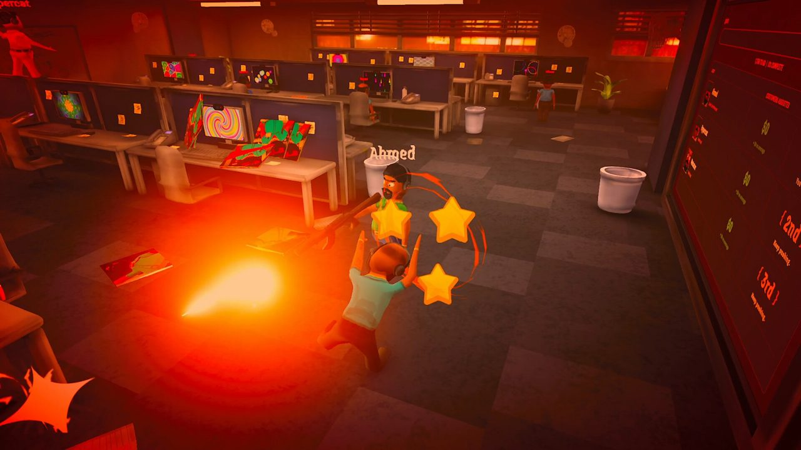

# Scam With Your Friends — карточка стиля

- Steam: https://store.steampowered.com/app/4954910/Scam_With_Your_Friends/
- Разработчики: JakeHub, Metater · ранний доступ, окт 2026
- Кластер: [coop-chaos-fp](../../genres/coop-chaos-fp.md) (подтип «офисный симулятор-вечеринка»)
- Теги: Online Co-Op, Voice Control, Job Simulator, Dark Comedy, Party Game, Hacking
- Суть: кооп «колл-центр мошенников» — разводить ИИ-звонящих, интерфейс фальшивого рабочего стола.

Листы: [скриншоты](img/shots_sheet.jpg) · [трейлер](img/frames_sheet.jpg) · Steam-скрин: https://shared.akamai.steamstatic.com/store_item_assets/steam/apps/4954910/bcff5f79257b09d3477d82fbfc880c4d084bfee2/ss_bcff5f79257b09d3477d82fbfc880c4d084bfee2.1920x1080.jpg

## Рендер
- [видно] Два слоя: **3D-офис** (мультяшный, гладкий, Roblox-подобные пропорции персонажей) и **2D-интерфейс рабочего стола** — основная часть геймплея.
- [видно] 3D: низкодетальные пропсы, мягкий тёплый свет офисных ламп, местами сильные цветные сцены (огонь, красная тревога).
- [видно] Портреты звонящих — 2D-карикатуры (чёрная линия, плоская заливка, мятный фон) — стиль комикса.

## Цвет и свет
- Палитра: `#4b2a23` / `#140907` тёмный тёплый офис · `#915f44` дерево · `#e8d8c0` бумага/UI · `#6897a8` / `#456070` синий рабочий стол · `#762919` красный тревоги.
- Яркость 89 (самая тёмная в пачке), насыщенность 22%. Тёплый полумрак + синий холодный экран.

## Камера
- [видно] FP в 3D офисе; большую часть времени — экран ПК во весь кадр (2D UI поверх).

## Персонажи
- [видно] Пухлые мультяшные коллеги, большие головы, крупные рты, оранжевая кожа, наушники с микрофоном. Анимация утрированная.

## Анимация / juice
- [видно] **Главное: juice UI** — огромные всплывающие «+$600» в зелёной плашке, тряска текста, субтитры-реплики жирным белым с обводкой, «CALL TERMINATED», «YOU'RE FIRED!» с наклоном.
- [видно] Окна приложений всплывают, мигает индикатор «Caller trust» (TRUSTING/NEUTRAL/ANGRY) с цветом.

## VFX и пост
- [видно] Огонь, звёздочки-удары (жёлтые), цветная спираль на мониторах, ч/б кадр для «перемотки» (FF ▶▶). В 3D — bloom, тёплый грейдинг.

## UI (главный элемент стиля)
- Фейковая ОС: панель задач снизу, окна с заголовками, иконки-приложения (пародии). Крупные красные/жёлтые кнопки «Hang up», «Verify», «HOLD TO BUY».
- Отчёт в конце дня — бумажная карточка с рейтингом игроков (бежевая бумага, красные заголовки с засечками).

## Как повторить
- 3D: Three.js, `MeshStandardMaterial` roughness 0.7, тёплые `PointLight` над столами, AO.
- UI: DOM-оверлей, имитирующий рабочий стол; анимации — GSAP + UIFX (pop, shake, jelly), пресеты «Arcade»/«Playful Jelly».
- Портреты: SVG/PNG 2D с чёрной обводкой 3px, плоская заливка.
