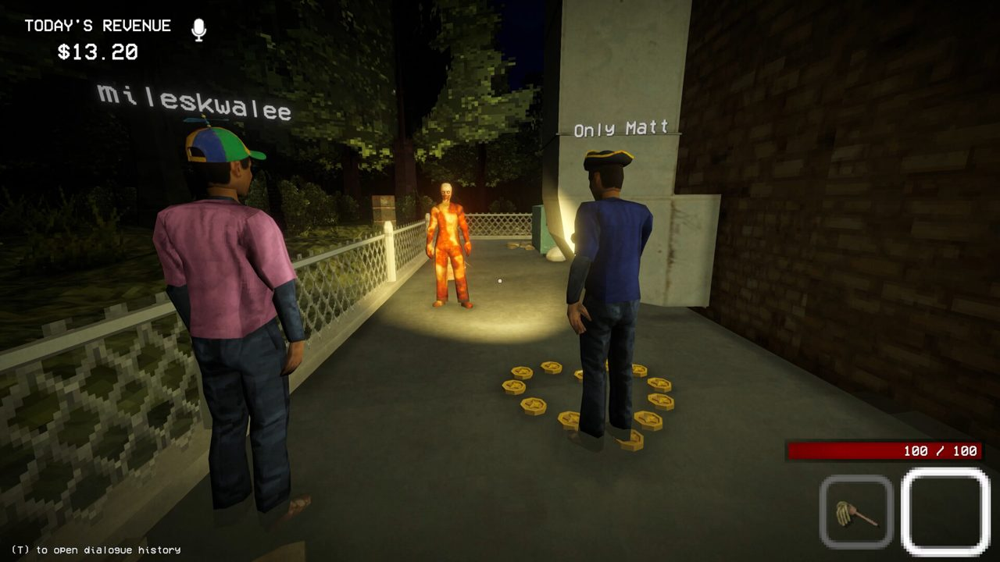
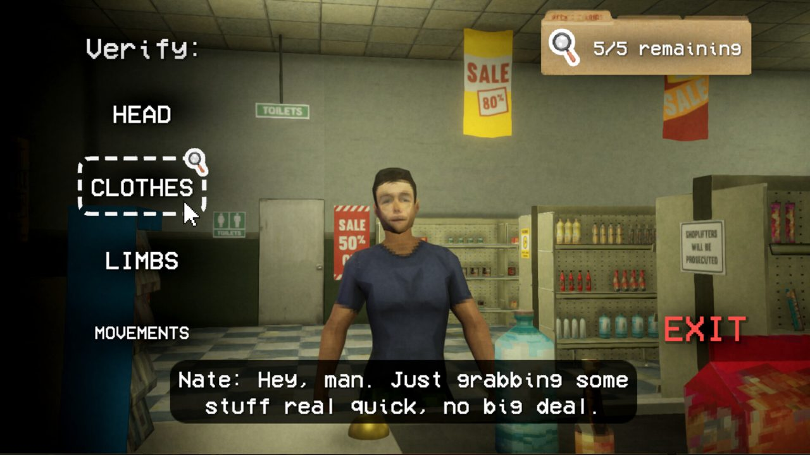
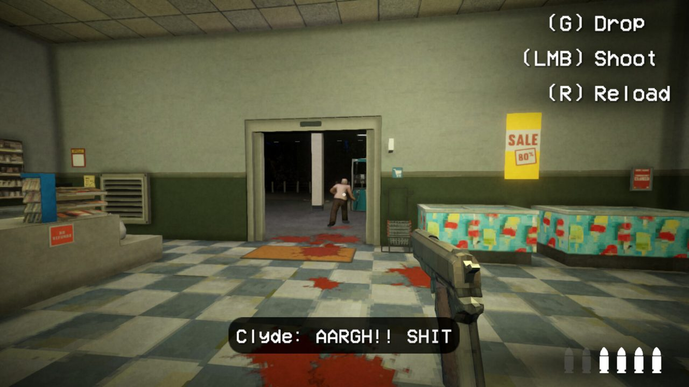

# Shift At Midnight — карточка стиля

- Steam: https://store.steampowered.com/app/3722330/Shift_At_Midnight/
- Разработчик: Bun Muen · 22 июл 2026
- Кластер: [horror](../../genres/horror.md), линия «ретро-PS1 кооп-хоррор»
- Теги: Horror, Online Co-Op, Retro, Survival Horror, First-Person, Comedy, Investigation, 1990's
- Суть: кооп до 3 игроков, ночная смена на заправке 1993 года. Проверяешь покупателей: некоторые только притворяются людьми. Ошибся — заколачивай окна, ставь ловушки и прячься.

Листы: [скриншоты](img/shots_sheet.jpg) · [трейлер](img/frames_sheet.jpg) · Steam-скрин: https://shared.akamai.steamstatic.com/store_item_assets/steam/apps/3722330/a7b10d3b321f42e8b8c0c75a1c6202802ecd6f21/ss_a7b10d3b321f42e8b8c0c75a1c6202802ecd6f21.1920x1080.jpg

## Рендер (сверено с проектом, 2026-11-20)
- [факт] **Не PSX-рендер.** Разрешение полное, пикселизации, экранного дизеринга и vertex snapping нет. Ретро-вид держится на текстурах и посте.
- [факт] URP Forward+, почти все материалы стандартный Lit. 84% полностью матовые (smoothness 0), металла нет.
- [факт] Текстуры 64–512 px (бетон 32), **point-фильтр** у 90%. Пропсы ~125 треугольников, люди 3–6 тыс. на скелете Mixamo.
- [факт] Свет запечён (100+ точечных ламп и прожекторов, реалтайм-теней нет). Ambient почти чёрный, туман exp² **чёрный** 0.01. Сильный SSAO (интенсивность 16, радиус 0.23).
- [факт] Пост: Neutral, bloom 0.8 / 1, виньетка 0.39, зерно 0.33, **lens distortion −0.2**, контраст +5. Есть локальные режимы CCTV, Blink, Static, Drunk.
- Полный разбор: `Downloads/WebAIGames/ShiftMidnight` → отчёт CLINIC 13 `reference/SHIFT_AT_MIDNIGHT_ANALYSIS.md`.

## Цвет и свет
- Палитра: `#19130d` / `#0a0a07` тёмная ночь · `#6b6b49` / `#544b34` / `#333628` оливково-зелёный флуоресцент · `#9ea27e` светлые стены · `#361816` красная тревога, кровь.
- Яркость 57, насыщенность 10%. Грязная зеленовато-жёлтая гамма магазина, ночь чёрная.
- [видно] Два режима света: (1) «смена» — холодный флуоресцент; (2) «нападение» — **красная заливка** всей сцены и фонарик/дульные вспышки.

## Камера
- [видно] FP, видна рука с оружием или шваброй, FOV ~75–80. Фонарик в темноте.

## Персонажи
- [видно] Полуреалистичные low-poly люди с запечёнными лицами; у игроков смешные шапки и конусы на голове (комедийный кооп). Монстры: оранжевые светящиеся фигуры, «притворщики».

## Анимация
- [видно] Простые: idle покупателей, ходьба. Хоррор держится на событиях, а не на анимации.

## VFX и пост
- [видно] Красные кровавые брызги и лужи, дульные вспышки, фонарик с мягким конусом, всплески краски. Тёмная виньетка.

## UI (сильная сторона)
- [видно] **Моноширинный ретро-шрифт** (стиль терминала и VHS). Меню проверки: «Verify: HEAD / CLOTHES / LIMBS / MOVEMENTS» с пунктирной рамкой и лупой.
- [видно] Фейковая база данных «NET Database» в окне в стиле Windows 95 (голубой, бежевая рамка, кнопка X). Субтитры в чёрной скруглённой плашке, «EXIT» красным.
- [видно] Счётчики выручки сверху, никнеймы над головами, голос.

## Как повторить в Three.js
- Рендер в полном разрешении, текстуры 64–256 px с `NearestFilter` (mag) и mipmaps, материалы `MeshStandardMaterial` с roughness 1 и metalness 0.
- Свет: запечённые lightmap или AO-карты из Blender + несколько тёплых `PointLight` `#fffdb3`. Тревожные лампы `#ff6e6b` / `#8f3333`. Фонарик `SpotLight` `#ffdb7a` без теней. `FogExp2(#000000, 0.01)`, ambient почти чёрный.
- Пост (postprocessing): N8AO (сильный, малый радиус), Bloom threshold 0.8, Vignette 0.4, Noise 0.3, бочкообразная дисторсия −0.2, лёгкий контраст. Режимы Blink и CCTV — отдельные эффекты с анимацией веса.
- UI: DOM-окна в стиле Win95, пиксельные или моноширинные шрифты (VT323 / IBM Plex Mono, OFL).
