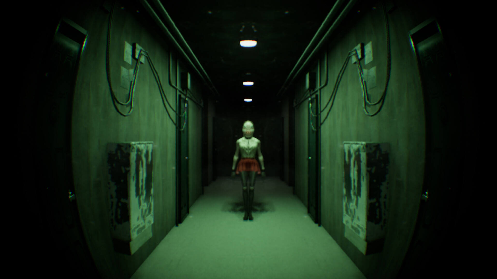
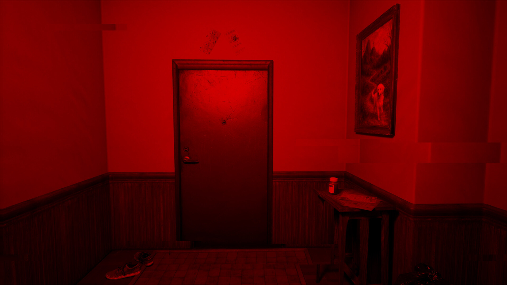
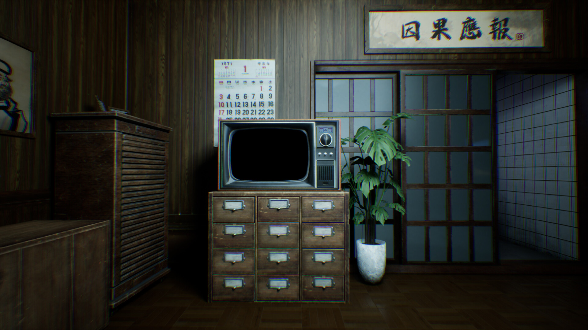

# Who's at the door? — карточка стиля

- Steam: https://store.steampowered.com/app/3690010/Whos_at_the_door/
- Разработчик: SKONEC Entertainment · 18 июл 2025
- Кластер: [horror](../../genres/horror.md), линия D «реалистичная квартира 90-х, психоз»
- Теги: Horror, Walking Simulator, Immersive Sim, First-Person, Realistic, 1990's, Mystery, Retro
- Суть: соло. Ты заперт в маленькой квартире, у тебя психоз. Каждую ночь кто-то стучит: решай, открыть или выпить таблетку; отличай реальность от галлюцинаций.

Листы: [скриншоты](img/shots_sheet.jpg) · [трейлер](img/frames_sheet.jpg)

## Рендер
- [видно] **Единственная почти реалистичная игра в библиотеке**: Unreal, PBR, деревянные панели, плитка, кожаный диван, азиатский интерьер 90-х (каллиграфия, календарь, ЭЛТ-телевизор, аквариум).
- [видно] Пространство маленькое и плотно обставленное: одна квартира = вся игра. Детализация высокая, но гамма приглушённая.
- [видно] Монстры и «гости» — гротескные, кукольные, с огромными выпученными глазами (резиновая кожа, детские пропорции). Это мостик к любимым у Alex утрированным глазам.

## Цвет и свет
- Палитра: `#000000` / `#050706` темнота · `#25110f` тёмное дерево · `#34342e` / `#5b594e` / `#8d8e84` серо-оливковые стены и плитка · `#4d0001` красная тревога.
- Яркость 28 (самая тёмная в библиотеке), насыщенность 7%.
- [видно] Три режима: **ночной зелёный** (коридор как в приборе ночного видения, фишай), **красная заливка** (опасность), **жёлто-тёплый** свет лампы у двери. Каждый режим — почти монохром.
- [видно] Мало источников: потолочный плафон, настольная лампа, свет из глазка. Остальное тонет в чёрном.

## Камера
- [видно] FP без рук, медленная, FOV ~70. **Вид в глазок — сильный фишай** с виньеткой. Крупные планы предметов (глазок, таблетки, ТВ).

## Анимация
- [видно] Мало: открывание двери, движения «гостей» в коридоре, рывки монстра. Страх через ожидание и детали.

## VFX и пост
- [видно] **VHS/ЭЛТ-глитч**: RGB-расслоение, помехи на телевизоре, зерно, хроматическая аберрация на галлюцинациях. Сильная виньетка, бочкообразная дисторсия в глазке.
- [видно] Мигание света, затемнения-«моргания» (чёрные кадры в трейлере).

## UI
- [видно] Почти нет HUD. Титры трейлера: **красный текст на чёрном** («OPEN THE DOOR OR TAKE YOUR PILL»), субтитры белым мелким по центру.
- [видно] Логотип: обшарпанный белый гротеск с красной подписью.

## Как повторить в Three.js
- Это не мультяшный стиль: брать **приёмы света и поста**, а не реализм. В проекте Alex лучше упростить модели (линия B) и оставить пост и режимы света.
- Режимы света: `PointLight` тёплый `#ffd9a0` у двери, плафон холодный; режим тревоги — заливка `#a00000` через ColorMatrix/LUT в postprocessing с анимацией веса.
- Глазок: отдельная камера с FOV 120 + barrel distortion + сильная виньетка; ночной режим — LUT в зелёный + зерно.
- Пост: Noise 0.3, ChromaticAberration на событиях, Vignette 0.5, Glitch-эффект для галлюцинаций (короткие вспышки).
