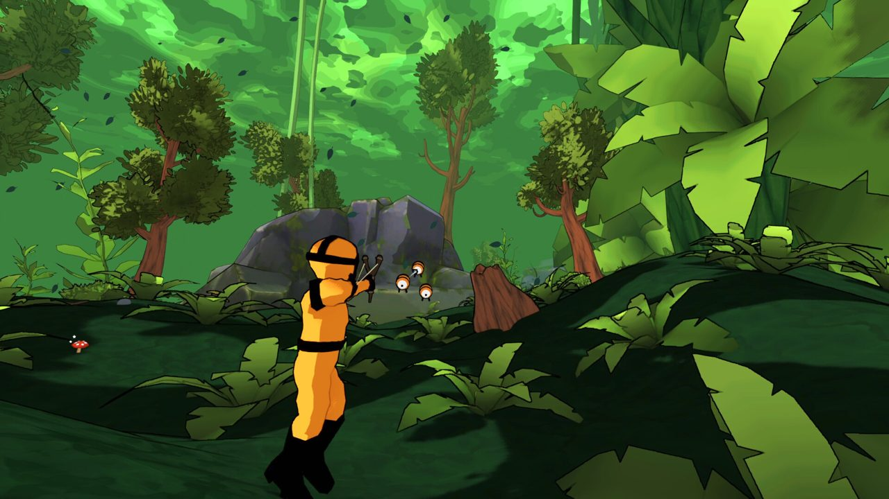
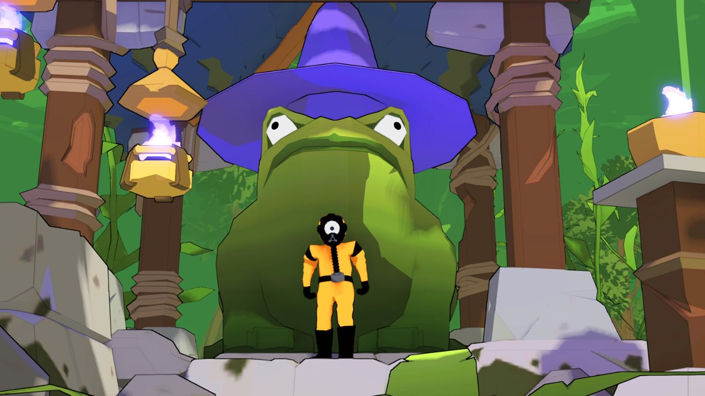
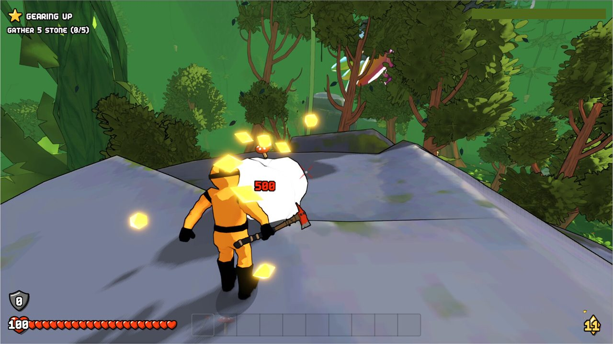

# Yellowcake — карточка стиля

- Steam: https://store.steampowered.com/app/2626770/Yellowcake/
- Разработчик: Barji (тот же, что Burg Tag и Barji Kart) · ещё не вышла
- Кластер: [horror](../../genres/horror.md), линия «мультяшный кооп-хоррор»; связь с линией Barji из [cartoon-movement-arcade](../../genres/cartoon-movement-arcade.md)
- Теги: Online Co-Op, Action Roguelike, Horror, Post-apocalyptic, Survival Horror, Cartoony, Stylized
- Суть: кооп в постъядерном мире: собираешь ресурсы, строишь ракету, бьёшься с боссами. Мир процедурный.

Листы: [скриншоты](img/shots_sheet.jpg) · [трейлер](img/frames_sheet.jpg) · Steam-скрин: https://shared.akamai.steamstatic.com/store_item_assets/steam/apps/2626770/22d989053db3d28040991c10cd5c552a6916c116/ss_22d989053db3d28040991c10cd5c552a6916c116.1920x1080.jpg

## Рендер
- [видно] **Toon/cel shading**: резкая граница света и тени на персонажах, плоские заливки, на листве рисованные мазки. На силуэтах персонажей видна чёрная обводка или тёмный контур [гипотеза: обводка через inverted hull].
- [видно] Густые сочные джунгли: крупные листья-плоскости, грибы в горошек (как в Barji Kart), камни с мазковой текстурой.
- [видно] Хоррор здесь в теме и монстрах, а не в темноте: картинка яркая, но насыщенно-тёмная.

## Цвет и свет
- Палитра: `#2c4126` / `#202614` / `#0a180e` тёмные джунгли · `#758f54` светлая листва · `#6e6430` / `#60442e` / `#402c1f` земля и дерево · `#000000` глубокие тени. Акцент: **жёлто-оранжевый костюм химзащиты** `~#f5a623`; оранжевое небо `~#c8782a` в пустошах.
- Яркость 58, насыщенность 16%. Тёмно-зелёная база и один яркий тёплый акцент (герой), как в INSIDE, только в мультяшном стиле.
- [видно] Тёплое оранжево-токсичное небо (облака как от ядерного заката), в джунглях зелёный полумрак.

## Камера
- [видно] Третье лицо сзади и чуть сверху, средняя дистанция.

## Персонажи
- [видно] Игроки в жёлтых костюмах химзащиты с противогазом: одноглазый визор, чёрные перчатки и сапоги, крупный силуэт.
- [видно] Монстры «Bungas»: серые одноглазые капли с розовыми губами, ходят толпой. Мультяшно-жутко. Жаба-идол в шляпе волшебника.

## Анимация
- [видно] Бег мультяшный и утрированный, толпы монстров бегут волнами. Удары киркой, урон всплывает числом.

## VFX и пост
- [видно] Жёлтые искры на ударах, белые клубы дыма, свечение кристаллов и рун (голубое и фиолетовое), зелёные лучи сверху. Bloom на светящихся объектах.

## UI
- [видно] Пиксельный шрифт, HP-полоска из красных сегментов внизу слева, хотбар снизу, квест слева сверху со звездой («GEARING UP, gather 5 stone»). Никнеймы над головами.
- Интро и финал: тонкий белый шрифт с засечками на чёрном («Our heroes were unsuccessful in their mission»), контраст ирония/драма.

## Как повторить в Three.js
- `MeshToonMaterial` с gradientMap из 2–3 ступеней (`NearestFilter`). Обводка: inverted hull (BackSide, scale 1.02, чёрный) или OutlineEffect из postprocessing.
- Листва: плоскости с alpha-текстурой мазков, `alphaTest 0.5`, лёгкое покачивание в вершинном шейдере.
- Свет: тёплый `DirectionalLight` `#ffb36b` + зелёный `HemisphereLight` `#4a6a3a` / `#1a1408`; `Fog` `#1d2a17`.
- Пост: Bloom по emissive (кристаллы и руны), лёгкая виньетка.
