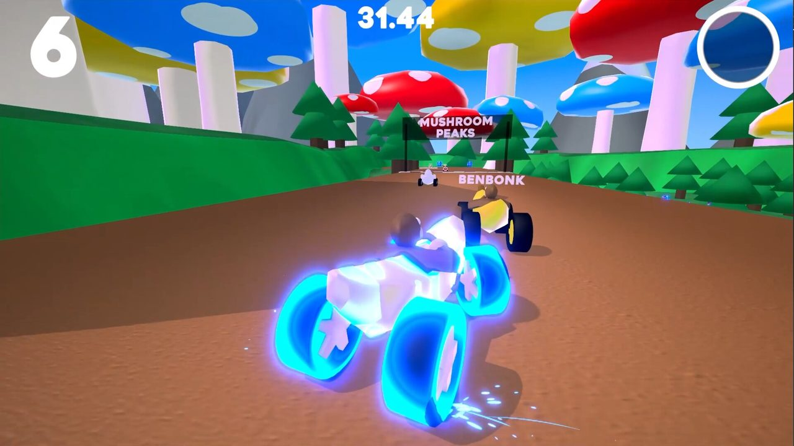
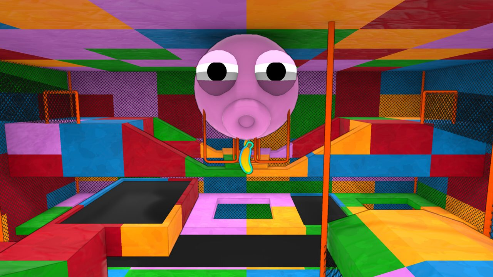
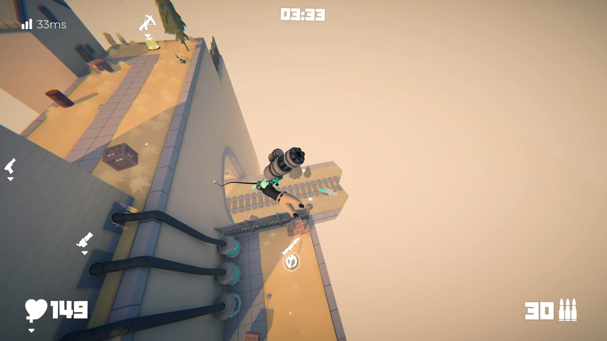
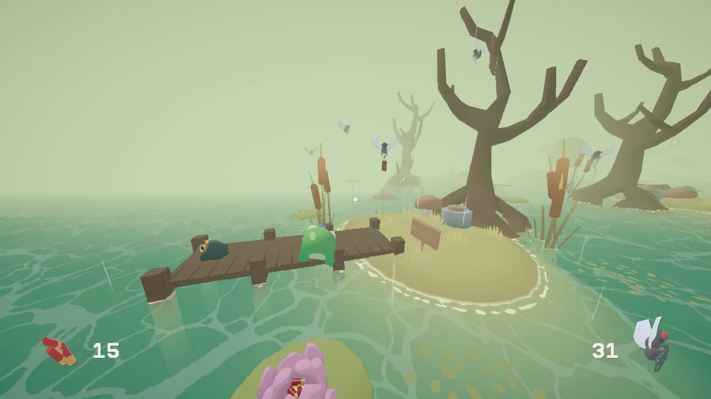

# Шаблон: мультяшная аркада с физичным движением

Игры: [Burg Tag](../games/burg-tag/CARD.md) · [Barji Kart](../games/barji-kart/CARD.md) · [Grapples Galore](../games/grapples-galore/CARD.md) · [Gun Frog](../games/gun-frog/CARD.md)

Когда применять: казуальный мультиплеер/PvP, паркур, гонки, шутер с движением, «весело двигаться» — главная ценность.

Две подлинии (два разработчика — два почерка):

## Линия «Barji»: яркий Roblox-like
Игры: Burg Tag, Barji Kart (и Yellowcake в хорроре).

- Насыщенность ~30–32%, **чистые primary-цвета** (красный, синий, жёлтый, зелёный, розовый), голубое небо с мультяшными облаками.
- Простые формы, рисованные мазковые текстуры (Burg Tag) или плоские цвета (Barji Kart).
- Персонажи-маскоты: огромные глаза с толстыми веками, перчатки, шапки (кастомизация — часть стиля).
- VFX: **неоновые бусты** (fresnel-обводка, искры, огненный ореол), сильный bloom на эффектах.
- UI: жирный круглый шрифт с толстой тёмной обводкой (UIFX **Roblox Cartoon**).
- Камера: FP с кулаками (Burg Tag) или за машиной (Barji Kart), FOV-кик на скорости.

## Линия «Zoteling»: пастельный туман
Игры: Grapples Galore, Gun Frog.

- Насыщенность 15–18%, яркость 130–145: **пастель, пыльная гамма**.
- **Туман = цвет неба**, вся сцена тонирована одним тоном (персик/мята/розовый) — главный приём.
- Low-poly гладкие формы без текстур, мягкие тени.
- Active ragdoll, физическая отдача = движение, крюк-кошка.
- VFX графичные: чёрные кляксы-взрывы, белые клубы дыма.
- Пост: виньетка, лёгкая хроматика, зерно.
- UI: белый угловатый/моноширинный шрифт, минимум (HP, патроны, таймер).

## Общее ядро
1. Движение — главный аттракцион: инерция, импульсы, FOV-кик, наклон камеры.
2. Физика тела (ragdoll/active ragdoll) и смешные падения.
3. Кастомизация шапок/скинов.
4. HUD минимальный, крупный, читаемый с одного взгляда.

## Чек-лист сверки
- [ ] Выбрана линия: Barji (яркая) или Zoteling (пастель-туман)
- [ ] Насыщенность в коридоре линии (замер скриптом палитры)
- [ ] Ощущение скорости: FOV-кик, трейлы, камера
- [ ] Эффекты буста/выстрела с bloom
- [ ] Шрифт и UIFX-пресет соответствуют линии
