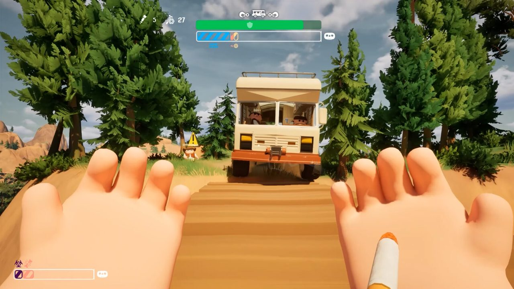
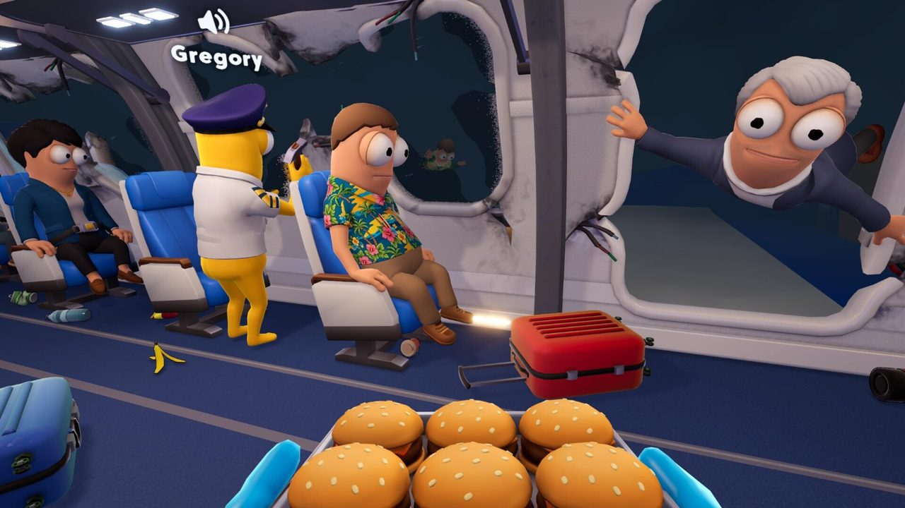

# Шаблон: кооп-хаос от первого лица («friend-slop»)

Игры: [RV There Yet?](../games/rv-there-yet/CARD.md) · [Dear Passengers](../games/dear-passengers/CARD.md) · [How to Fish](../games/how-to-fish/CARD.md) · [Scam With Your Friends](../games/scam-with-your-friends/CARD.md) · [PEAK](../games/peak/CARD.md) · [Lethal Company](../games/lethal-company/CARD.md) (хоррор-край жанра)

Когда применять: кооп 1–4 игрока, комедия, физика и хаос, первое лицо, «работа/поездка/выживание с друзьями».

## Общее ядро (обязательно)
1. **Камера FP с крупными руками в кадре.** Руки мультяшные, гипертрофированные (толстые пальцы, перчатки, «колбаски»). FOV 85–100. Предмет в руке = инструмент + часть UI.
2. **Мультяшные пухлые персонажи** с большой головой (1/3–1/4 роста) и смешными лицами; главный юмор — **глаза** (выпученные шары, очки, точки).
3. **Физика и ragdoll как комедия.** Всё падает, болтается, летает: персонажи, предметы, техника. Rapier обязателен.
4. **Диегетический UI**: пульты, приборные панели, экраны ПК, книжки-инструкции; HUD минимальный (полоски + подсказки клавиш мелко).
5. **Никнеймы над головами + иконка голоса** (proximity voice — часть жанра).
6. **«Настоящий» мягкий свет поверх мультяшных форм**: AO, мягкие тени, тёплый тонмаппинг, bloom на небе/огне.

## Варианты рендера (выбрать один на проект)
| Вариант | Референс | Ключ |
|---|---|---|
| A. Глина/пластилин в реальном свете | RV There Yet? | гладкие скруглённые формы, roughness 0.8, тёплое солнце, пыль |
| B. Яркий мультсериал | Dear Passengers | чистые насыщенные цвета, выпученные глаза, много пропсов-хаоса |
| C. Low-poly flat (Landfall) | How to Fish | видны грани, flatShading, жёсткие тени, кровь-кубики |
| D. 3D + 2D-интерфейс | Scam With Your Friends | 3D-сцена тёплая тёмная, основной геймплей в juicy DOM-UI |
| E. Тун-приключение в цветном воздухе | PEAK | 2–3-ступенчатый toon без обводки, нарисованные плоские лица, каждый биом — свой цвет тумана и неба |
| F. Ретро кооп-хоррор | Lethal Company | низкое разрешение + постеризация + обводка, визор шлема, тьма и фонарик; см. horror.md линия B |

## Палитра жанра
- База тёплая или голубая, насыщенность 20–27%, яркость 90–120. Яркие акценты (красный/жёлтый/зелёный) только на пропсах и персонажах.

## Анимация
- Процедурные FP-руки (тянуться, хватать, bob), ragdoll падения, physics-предметы, squash на ударах.
- Утрированные лица (вращение зрачков, рот).

## VFX и пост (минимум)
- N8AO, Bloom (0.8–0.85), AgX/ACES, туман по глубине; пыль/дым/искры (three.quarks), всплывающие числа/текст комбо.

## UI
- UIFX пресет **Playful Jelly** или **Arcade** (для «Scam»-типа). Крупные всплывающие награды («+$600»), тряска, жирный шрифт с обводкой.

## Чек-лист сверки
- [ ] Руки в кадре, FOV 85–100
- [ ] Персонаж с утрированными глазами/головой
- [ ] Ragdoll и физика предметов работают в кадре
- [ ] Мягкие тени + AO + тёплый тонмаппинг
- [ ] HUD ≤ 3 элемента, остальное диегетически
