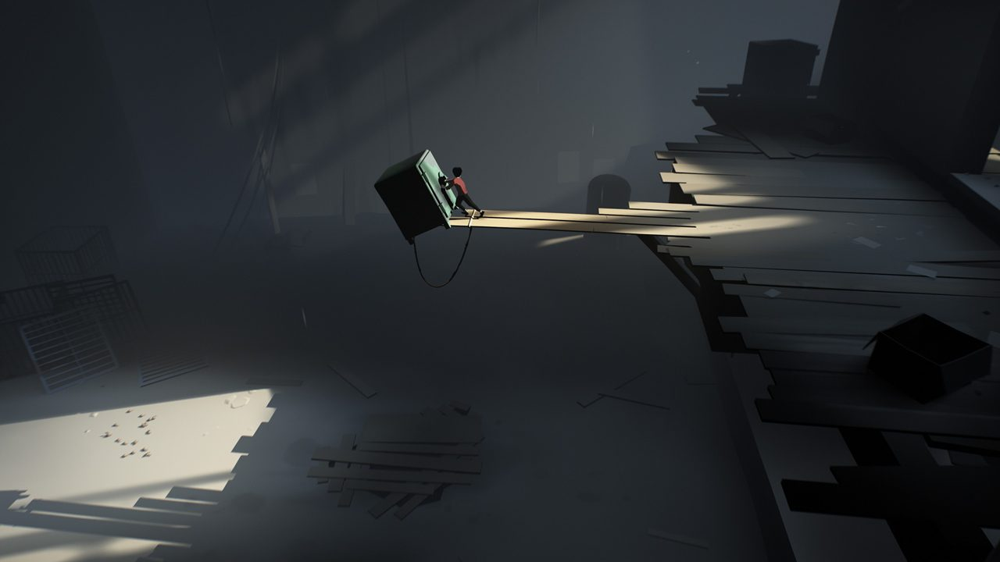
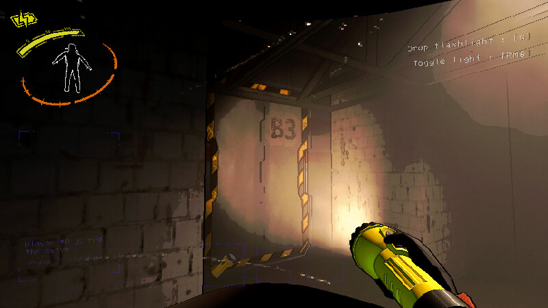
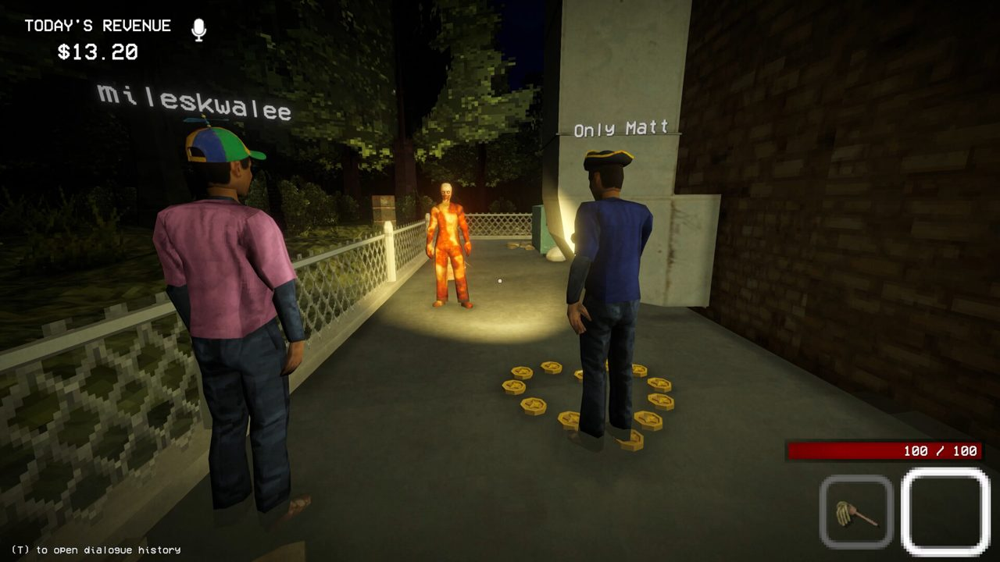
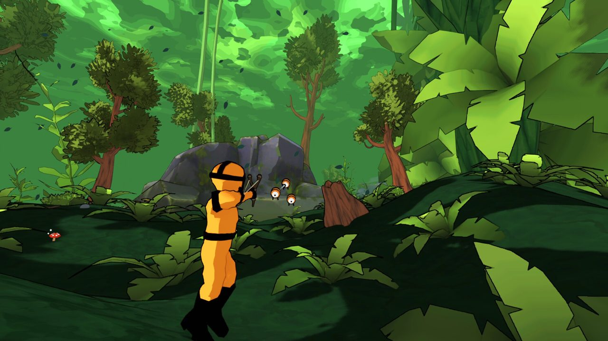
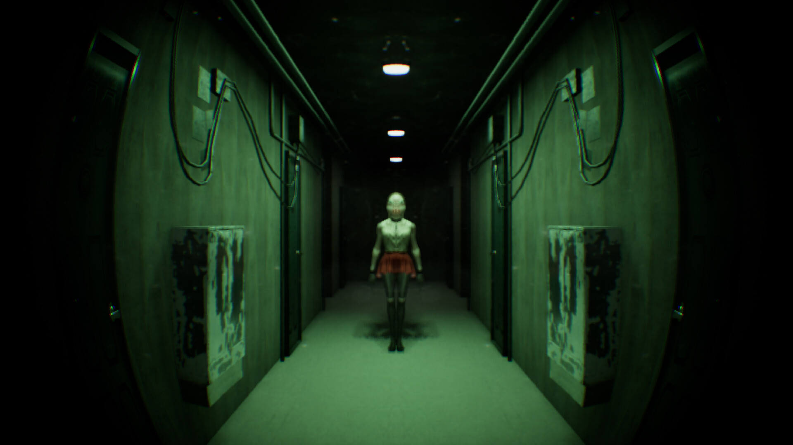

# Шаблон: хоррор и атмосфера

Игры: [INSIDE](../games/inside/CARD.md) · [Shift At Midnight](../games/shift-at-midnight/CARD.md) · [Lethal Company](../games/lethal-company/CARD.md) · [Yellowcake](../games/yellowcake/CARD.md) · [Who's at the door?](../games/whos-at-the-door/CARD.md)

Когда применять: хоррор, мрачное приключение, survival, кооп-хоррор с юмором.

Четыре линии, у каждой свой способ пугать.

## Линия A. Мрачный минимализм (INSIDE)

- Почти ч/б (насыщенность ~4%, яркость ~34), холодный графит. **Один красный акцент** на герое.
- Гладкие формы без текстур, персонажи без лиц. Пугают масштаб, тишина, толпы одинаковых фигур.
- Свет решает всё: 1–2 сильных источника, volumetric-лучи, густой туман, многослойная глубина силуэтов.
- Камера сбоку (2.5D), узкий FOV, длинные кадры. **UI нет.**
- Пост: god rays, зерно, глубокая виньетка, bloom на источниках.

## Линия B. Ретро кооп-хоррор (Lethal Company → Shift At Midnight)

- **Lethal Company — эталон линии**: низкое внутреннее разрешение с крупным пикселем, постеризация 6–8 уровней, тонкая обводка, визор шлема по краям кадра, диегетический HUD шлема (дуга здоровья, моноширинные подсказки), зелёный терминал. Серо-коричневая база + оранжевые костюмы и жёлто-чёрные полосы опасности. Снаружи густой туман, внутри темнота и конус фонарика.

- Low-poly, текстуры 64–256 px с nearest-фильтром при **полном** разрешении рендера (не PSX). Матовый Lit, запечённый тёплый свет, чёрный туман, сильный AO. Сеттинг: будничное место 90-х (заправка, магазин).
- Два режима света: обычная смена (зеленоватый флуоресцент) и тревога (**красная заливка**, фонарик, дульные вспышки).
- FP, оружие или инструмент в руке. Юмор в коопе (шапки-конусы, голос).
- UI: моноширинный ретро-шрифт, окна в стиле Win95, меню проверки с пунктирной рамкой.
- Пост: виньетка, зерно, бочкообразная дисторсия −0.2. Пикселизации нет. Режимы Blink и CCTV — локальные Volume.

## Линия C. Мультяшный кооп-хоррор (Yellowcake)

- Toon/cel shading с обводкой, рисованная листва, тёмно-зелёная база. Жёлто-оранжевый акцент героя (костюм химзащиты).
- Пугают монстры и тема: одноглазые толпы, постъядерное оранжевое небо. Картинка не тёмная, а насыщенно-сумрачная.
- Камера от третьего лица, кооп, roguelike-лут, пиксельный HUD.
- Это мост к линии Barji: тот же разработчик, грибы в горошек, мультяшные пропорции.

## Линия D. Тесная квартира 90-х, психоз (Who's at the door?)

- Одна маленькая обставленная квартира = вся игра. Модели почти реалистичные (Unreal), но у Alex брать **свет и пост**, а модели упрощать до линии B.
- Свет режимами-монохромами: ночной зелёный, красная заливка, тёплая лампа у двери. Яркость ~28, самая тёмная в библиотеке.
- Глазок с сильным фишаем, VHS/ЭЛТ-глитч и хроматика на галлюцинациях, «моргания» чёрным. Гости-куклы с выпученными глазами.
- Механика «проверь, кто перед тобой» общая с Shift At Midnight: это любимый у Alex тип хоррора.

## Общее ядро хоррора у Alex
1. **Один тёплый или красный акцент на тёмной холодной базе** (красная кофта, жёлтый костюм, красная тревога).
2. **Свет как главный инструмент**: туман, мало источников, контраст света и тени. Яркость 34–58.
3. **Низкая насыщенность базы** (4–16%).
4. Хоррор держится на атмосфере и ситуации, а не на скримерах. В коопе хоррор смешан с юмором (B, C).
5. HUD минимальный или отсутствует; если есть, то стилизован под эпоху (ретро-шрифт, пиксели).

## Чек-лист сверки
- [ ] Выбрана линия A, B, C или D
- [ ] Средняя яркость и насыщенность в коридоре линии (скрипт палитры)
- [ ] Есть один яркий акцент на тёмной базе
- [ ] Туман и объёмный свет работают в кадре
- [ ] Пост: виньетка, зерно и bloom на источниках
- [ ] UI соответствует линии (нет / ретро / пиксельный)
